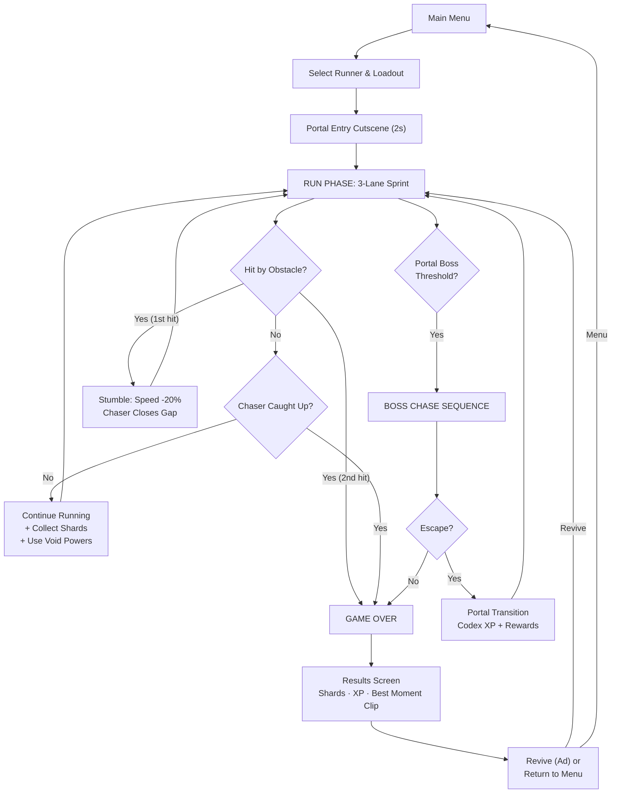
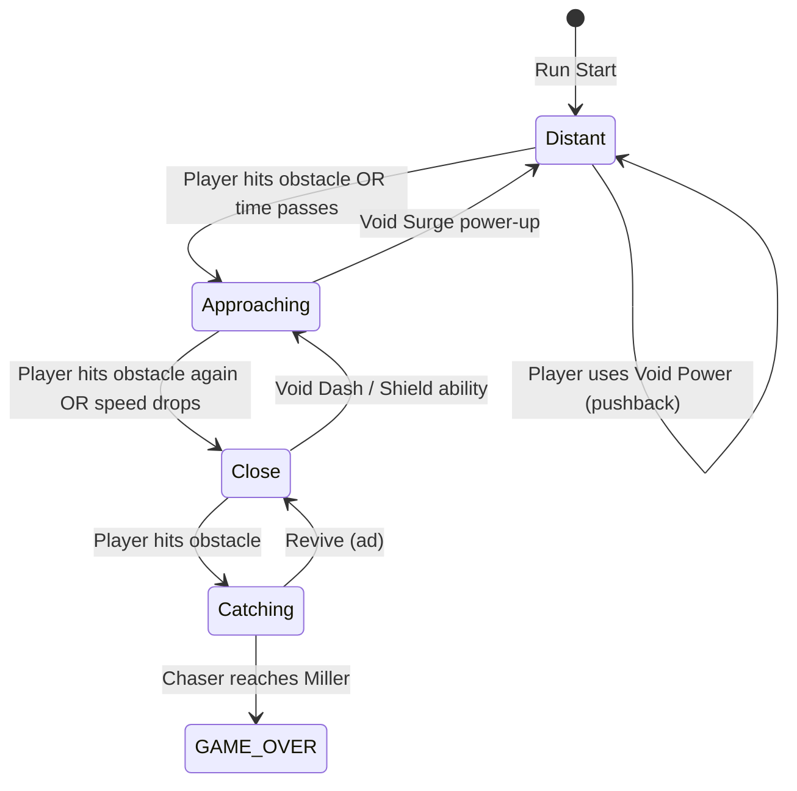

# MILLER: VOID RUN — Game Design Document
## Part 1 (A–E): Overview, Core Loop, Controls, Chaser System, Obstacles & Track Generation

---

## A. GAME OVERVIEW

### High Concept
**MILLER: VOID RUN** is a fast, stylised 3D endless runner for Android where Miller Redwolf — a secretly overpowered F-Rank hunter — sprints through collapsing portal worlds, wielding forbidden void powers from the Umbral Codex while hunted by escalating beast-tier pursuers and enemy faction agents.

### Unique Selling Points
1. **Void Power System** — Every ability maps to a canon Codex stage; your power kit evolves as your Codex level grows across runs
2. **Collapsing Portal Worlds** — The track itself is disintegrating behind you; the world is the timer
3. **Beast-Tier Chaser** — Not a generic pursuer but a named beast from the story's tier system, each with unique behaviours
4. **Faction Boss Runs** — Climax sequences themed to Obscura, Crimson Hand, Veridian Accord, and Dominion Authority
5. **TikTok Moments** — Auto-captured slow-motion near-miss clips, screen-filling void eruptions, and boss escapes designed for shareability

### Tone & Rating
- **Tone:** Dark-fantasy action with moments of humour (Leonard's banter, Harry's detective asides)
- **Rating:** PG-13 — stylised violence, void energy effects, no gore, no blood, all relationships kept PG-13
- **Aesthetic:** Deep purples, void-black, neon void-glow accents, strong silhouette readability

### Target Metrics

| Metric | Target |
|---|---|
| Platform | Android (Unity 2022 LTS, URP) |
| Orientation | Portrait |
| FPS | 60 target / 30 fallback |
| Session length | 2–3 minutes |
| Input style | One-thumb, swipe + tap |
| APK size | < 150 MB base, worlds 2–7 as asset packs |
| Min spec | Snapdragon 665 / Mali-G52, 3 GB RAM |

---

## B. CORE GAME LOOP

### Session Flow



### Run Pacing (per portal world)

| Phase | Distance (m) | Duration (~) | Intensity |
|---|---|---|---|
| Ramp-Up | 0 – 300 | 0:00 – 0:25 | Low — learn the portal's obstacles |
| Cruising | 300 – 800 | 0:25 – 1:10 | Medium — full obstacle set, chaser visible |
| Pressure | 800 – 1400 | 1:10 – 1:50 | High — faster speed, chaser closing |
| Boss Chase | 1400 – 1800 | 1:50 – 2:20 | Peak — scripted boss encounter |
| Transition | 1800+ | 2:20 – 2:30 | Cool-down — portal collapse → next world |

### Difficulty Curve [NEW]
- **Base speed** increases by 5% per portal world entered (compounding)
- **Obstacle density** scales: `density = baseRate × (1 + 0.08 × portalIndex)`
- **Chaser aggression** increases each world (see Section D)
- Soft cap at world 7; after that, density plateaus but obstacle patterns become more complex

---

## C. CORE CONTROLS

### Input Map (Portrait, One-Thumb)

| Input | Action | Details |
|---|---|---|
| Swipe Left | Lane change left | Move one lane left (3 lanes: L, C, R) |
| Swipe Right | Lane change right | Move one lane right |
| Swipe Up | Jump | 0.6s airtime, clears ground obstacles |
| Swipe Down | Roll / Slide | 0.5s slide under overhead obstacles |
| Tap (Void Button) | Activate Void Power | Bottom-right floating button, see Section F |
| Double-tap (Void Button) | Swap Void Power | Cycles through equipped abilities [NEW] |
| Hold (Void Button) | Charged Void Power | Available for select abilities at higher Codex stages [ADAPTED] |

### Input Buffering System [NEW]

> [!IMPORTANT]
> Input buffering is critical for feel. A runner that drops inputs during animations feels broken.

```
┌─────────────────────────────────────────────────────┐
│                INPUT BUFFER SYSTEM                  │
├─────────────────────────────────────────────────────┤
│ Buffer Window:  150 ms (≈ 9 frames @ 60fps)        │
│ Queue Depth:    1 input (last-wins)                 │
│ Priority:       Lane change > Jump > Roll > Power   │
│                                                     │
│ During lane-change animation (200 ms):              │
│   → Next swipe is queued and fires on anim end      │
│                                                     │
│ During jump/roll (500-600 ms):                      │
│   → Lane swipe is queued and fires on landing       │
│   → Second jump/roll is discarded (no double-jump)  │
│                                                     │
│ During stumble (400 ms):                            │
│   → All inputs queued, fire on recovery             │
│   → Void Power remains usable during stumble        │
└─────────────────────────────────────────────────────┘
```

### Hitbox Forgiveness [NEW]

| Element | Visual Size | Collision Size | Forgiveness |
|---|---|---|---|
| Miller (standing) | 0.6 m wide × 1.8 m tall | 0.4 m × 1.5 m | 33% / 17% smaller |
| Miller (sliding) | 0.6 m × 0.6 m | 0.5 m × 0.5 m | 17% smaller |
| Ground obstacle | 1.0 m × 1.0 m | 0.85 m × 0.85 m | 15% smaller |
| Overhead beam | 1.0 m × 0.4 m | 0.85 m × 0.35 m | 15% / 12% smaller |
| Collectibles | 0.3 m radius | 0.6 m radius | 2× generous pickup |

> [!TIP]
> Forgiveness ratios can be tuned per-difficulty. Early portals use the values above; later portals can tighten obstacle hitboxes by 5% each world for added challenge without changing visuals.

### Lane Geometry [NEW]

```
        ← 3.6 m total track width →

   |  Lane L  |  Lane C  |  Lane R  |
   | ←1.2 m→  | ←1.2 m→  | ←1.2 m→  |
   
   Lane change: 200 ms ease-in-out lerp
   Lane snap:   If swipe starts >60% through, snap instantly
```

### Swipe Detection Parameters [NEW]

| Parameter | Value | Notes |
|---|---|---|
| Min swipe distance | 40 px (density-independent) | Prevents accidental triggers |
| Max swipe time | 300 ms | Longer = not a swipe |
| Directional lock angle | 30° from axis | Disambiguates L/R from U/D |
| Dead zone | 15 px radius from touch-down | Prevents micro-jitter |
| Multi-touch | Void button uses separate touch ID | Swipe + tap simultaneously OK |

---

## D. CHASER SYSTEM

### Concept
A beast from the story's tiered beast system pursues Miller through each portal world. The chaser is always visible behind the player, growing larger and more aggressive as the run progresses. It serves as both a visual tension device and a fail-state mechanic.

### Chaser Assignment by Portal World

| Portal World | Portal Type | Chaser Beast Tier | Chaser Name | Key Traits (from canon) |
|---|---|---|---|---|
| 1 — Verdant Breach | Green | Advanced | Thornmaw [NEW] | Physically powerful, no abilities, charges in straight lines |
| 2 — Ember Corridor | Green/Orange | King | Skeld [NEW] | Accelerated Regeneration, Shapeshifting — changes form at speed thresholds |
| 3 — Obsidian Rift | Orange | Emperor | Dreadwhisper [NEW] | Telempathy (fear projection), Illusion Casting — spawns fake obstacles |
| 4 — Crimson Depths | Orange/Red | Legendary | Pyreclad [NEW] | Pyrokinesis — leaves fire trails, throws fireballs across lanes |
| 5 — Frozen Archive | Red | Demigod | Chronal Wyrm [NEW] | Time Manipulation, Gravity Manipulation — slows time in zones, warps track gravity |
| 6 — Abyssal Maw | Red/White | Demon | Voidstalker [NEW] | Summoning, Life Force Drain — summons minion waves, drains shards on proximity |
| 7 — The Terminus | White | Yigyang | Null Sovereign [NEW] | Intangibility, Dark Veil, Sonic Wave Compression — phases through obstacles, fires sonic waves |

> [!NOTE]
> Beast names are [NEW] — the document defines beast **tiers** and their possible abilities but does not name individual beasts. Each chaser above is built from the canon ability pool of its tier.

### Chaser Distance Mechanic



### Distance Values [NEW]

| State | Distance Behind Miller | Visual Cue | Audio Cue |
|---|---|---|---|
| **Distant** | 40–60 m | Small silhouette, dust cloud | Low rumble |
| **Approaching** | 20–40 m | Half-screen, eyes glow | Heartbeat layer added |
| **Close** | 8–20 m | Fills lower third, roaring | Breathing intensifies, screen vignette |
| **Catching** | 0–8 m | Reaching claws at screen edges | Distortion, panic SFX |
| **Caught** | 0 m | Grab animation → game over | Impact + void shatter |

### Chaser Movement Rules [NEW]

| Rule | Value | Notes |
|---|---|---|
| Base closing speed | +0.3 m/s faster than Miller's current speed | Constant slow gain |
| Closing on stumble | +2.5 m/s burst for 1.5s | Punishes hits heavily |
| Pushback on Void Power | −15 m knockback | Reward for using abilities |
| Pushback on near-miss | −3 m | Reward for skillful play |
| World transition | Reset to Distant (60 m) | Fresh start each portal |
| Boss Chase phase | Chaser pauses; boss takes over | No double-threat |

### Chaser Behaviour Tiers [ADAPTED from canon beast abilities]

**Tier 1 — Basic/Advanced (Worlds 1):**
- Linear pursuit, no special attacks
- Visual: charges in a straight line, smashes through debris behind player
- Stumble recovery: fast (player has more margin for error)

**Tier 2 — King (World 2):**
- Shapeshifting: chaser changes form every 300 m — becomes faster but thinner, or slower but wider
- Adaptation: if player stays in one lane too long (>5s), chaser speeds up

**Tier 3 — Emperor (World 3):**
- Illusion Casting: spawns 1–2 fake obstacles per 200 m (ghostly tint, 70% opacity) [ADAPTED]
- Fear Projection: at Close range, screen edges pulse red, controls invert briefly for 0.5s [ADAPTED]

**Tier 4 — Legendary (World 4):**
- Pyrokinesis: drops fire patches in random lanes that persist for 3s [ADAPTED]
- Energy Blasts: fires a projectile every 15s that must be dodged (occupies one lane) [ADAPTED]

**Tier 5 — Demigod (World 5):**
- Time Manipulation: creates slow-time zones (30% speed reduction for 2s) [ADAPTED]
- Gravity Manipulation: tilts track gravity — collectibles slide to one side, player drift [ADAPTED]

**Tier 6 — Demon (World 6):**
- Summoning: spawns 2–3 minion beasts that run alongside as moving obstacles [ADAPTED]
- Life Force Drain: when at Close range, Void Shards slowly drain (−5/s) [ADAPTED]

**Tier 7 — Yigyang (World 7):**
- Intangibility: phases through obstacles to close distance [ADAPTED]
- Sonic Wave: fires screen-wide wave every 20s — must jump over or roll under depending on height [ADAPTED]
- Dark Veil: periodically darkens screen for 1.5s, only void-glow elements visible [ADAPTED]

---

## E. OBSTACLES, HAZARDS & PROCEDURAL TRACK GENERATION

### Obstacle Categories

#### E.1 Ground Obstacles (Swipe Up to Jump)

| Obstacle | Height | Lanes | Variants per World |
|---|---|---|---|
| Void Rubble | 0.8 m | 1 lane | Broken stone (W1), molten rock (W2), crystal shards (W4) |
| Collapsed Pillar | 1.0 m | 2 lanes | Forces specific lane choice |
| Beast Carcass [NEW] | 0.6 m | 1 lane | Fallen lesser beast, world-themed |
| Rift Crack | ground-level gap | 1 lane | Void fissure — jump or fall (stumble) |
| Portal Fragment | 1.2 m | 1–2 lanes | Spinning shard of broken portal energy |

#### E.2 Overhead Obstacles (Swipe Down to Roll/Slide)

| Obstacle | Clearance | Lanes | Variants |
|---|---|---|---|
| Void Tendril | 1.0 m clear | 1 lane | Dark energy whip crossing lane |
| Fallen Archway | 0.7 m clear | 2–3 lanes | Must slide through |
| Energy Beam | 0.5 m clear | 1 lane | Horizontal beam of void energy |
| Low Canopy | 0.8 m clear | 2 lanes | World-themed (vines in W1, ice in W5) |

#### E.3 Moving / Dynamic Obstacles [NEW]

| Obstacle | Behaviour | Counter | Frequency |
|---|---|---|---|
| Roaming Beast | Moves between lanes every 2s | Time lane change | 1 per 200 m (worlds 3+) |
| Swinging Pendulum | Swings across 2 lanes on a cycle | Time passage | 1 per 300 m (worlds 2+) |
| Tracking Orb | Follows Miller's lane with 1s delay | Switch lane twice quickly | 1 per 400 m (worlds 4+) |
| Faction Soldier [NEW] | Runs toward Miller from ahead, occupies lane | Lane change or jump | Boss Chase only |

#### E.4 Portal-Collapse Hazards [ADAPTED]

| Hazard | Description | Mechanic |
|---|---|---|
| Void Collapse | Track behind Miller crumbles into void | Visual pressure — matches chaser pace |
| Rift Eruption | Void energy bursts from ground | 1.5s telegraph (glow), then 0.5s danger zone — jump or change lane |
| Reality Tear | Screen splits visually, track forks | Player picks a lane; wrong fork has denser obstacles |
| Portal Surge | Entire track accelerates for 3s | Speed boost + tighter reaction windows |
| Void Storm | Purple lightning across random lanes | 1s telegraph (shadow on ground), dodge |

### Obstacle Distribution by World [NEW]

| World | Ground % | Overhead % | Moving % | Collapse % | Special |
|---|---|---|---|---|---|
| 1 — Verdant Breach | 50 | 30 | 0 | 20 | None |
| 2 — Ember Corridor | 40 | 30 | 10 | 20 | Swinging Pendulums |
| 3 — Obsidian Rift | 35 | 25 | 15 | 25 | Fake obstacles from chaser |
| 4 — Crimson Depths | 30 | 25 | 20 | 25 | Fire trails from chaser |
| 5 — Frozen Archive | 30 | 20 | 20 | 30 | Ice physics (slide on lane change) |
| 6 — Abyssal Maw | 25 | 20 | 25 | 30 | Summoned minion beasts |
| 7 — The Terminus | 25 | 20 | 25 | 30 | Dark Veil blackouts, sonic waves |

### Procedural Track Generation System [NEW]

#### Chunk-Based Architecture

```
┌────────────────────────────────────────────────────────────────┐
│                    TRACK GENERATION PIPELINE                   │
├────────────────────────────────────────────────────────────────┤
│                                                                │
│  CHUNK POOL (per world, ~40 pre-designed chunks each)          │
│  ├── Easy chunks     (12)  — 1-2 obstacles, wide gaps          │
│  ├── Medium chunks   (14)  — 3-4 obstacles, mixed types        │
│  ├── Hard chunks     (10)  — 5-6 obstacles, combos             │
│  ├── Reward chunks   (4)   — shard/essence lines, few hazards  │
│  └── Event chunks    (bonus)— boss intro, portal transitions   │
│                                                                │
│  CHUNK DIMENSIONS                                              │
│  ├── Length: 30 m (≈ 2 seconds at base speed)                  │
│  ├── Width:  3 lanes × 1.2 m = 3.6 m                          │
│  └── Buffer: 5 m gap between chunks (empty breathing room)     │
│                                                                │
│  SELECTION ALGORITHM                                           │
│  ├── Difficulty score: D = baseD + (distance / 500) × scaleFac │
│  ├── D ∈ [0, 1] → weighted random from Easy/Med/Hard pools     │
│  ├── Reward chunk: guaranteed every 8–12 chunks                │
│  ├── No-repeat: same chunk cannot appear within last 5         │
│  └── Boss trigger: at distance threshold, inject Event chunk   │
│                                                                │
│  POOLING                                                       │
│  ├── Active chunks rendered:  6 ahead + 2 behind (recycling)   │
│  ├── On recycle: chunk returns to pool, obstacles reset         │
│  ├── Obstacle GameObjects:  pooled per type (max ~60 active)   │
│  └── Collectible objects:   pooled (max ~30 active)            │
│                                                                │
└────────────────────────────────────────────────────────────────┘
```

#### Chunk Composition Rules [NEW]

| Rule | Constraint | Reason |
|---|---|---|
| Min safe path | Every chunk must have ≥1 clear path through all 3 axes (lane, jump, slide) | Never unfair |
| Reaction time | Min 0.4s between consecutive obstacles at current speed | Human reaction limit |
| Combo cap | Max 3 consecutive "hard" actions (jump-slide-lanechange) | Avoid finger fatigue |
| Breathing room | After every Hard chunk, next chunk is Easy or Reward (60% chance) | Pacing |
| Lane bias | No more than 3 consecutive obstacles in the same lane | Force movement |
| Collectible placement | Shards placed along the optimal path through each chunk | Reward skill |

#### Speed Ramp [NEW]

| Distance (m) | Speed (m/s) | Relative | Feel |
|---|---|---|---|
| 0 – 300 | 12 | 1.0× | Comfortable jog |
| 300 – 800 | 14 | 1.17× | Brisk sprint |
| 800 – 1400 | 16.5 | 1.38× | Intense |
| 1400 – 1800 (Boss) | 18 | 1.50× | Boss chase pace |
| 1800+ (next world) | 12.6 (12 × 1.05) | 1.0× of new base | Reset + 5% faster base |

#### Track Visuals per Portal World (brief — full detail in Part 3)

| World | Ground Material | Skybox | Key Props | Lighting |
|---|---|---|---|---|
| 1 — Verdant Breach | Cracked earth + glowing moss | Twilight green sky, floating islands | Ancient trees, vine arches, stone altars | Warm amber + void-purple rim |
| 2 — Ember Corridor | Scorched basalt, lava veins | Smoke-red sky, ember particles | Ruined forge structures, molten rivers | Hot orange + deep shadow |
| 3 — Obsidian Rift | Black glass, mirror reflections | Starless void, floating shards | Crystal towers, refraction beams | Cool blue + sharp void-white |
| 4 — Crimson Depths | Blood-red stone, pulsing veins | Crimson fog, distant structures | Bone formations, faction banners | Deep red + black |
| 5 — Frozen Archive | Ice-blue crystal, frost patterns | Aurora borealis, frozen sky | Library ruins, frozen scrolls, time-locked zones | Ice-white + void-purple |
| 6 — Abyssal Maw | Void-black terrain, floating debris | Pure void, distant void-light | Teeth-like formations, void tendrils | Void-purple + neon accents |
| 7 — The Terminus | Fracturing reality tiles | Kaleidoscopic void | All previous world fragments | Shifting, unstable lighting |

#### Memory & Performance Budget [NEW]

| Resource | Budget | Strategy |
|---|---|---|
| Active chunks | 8 (6 ahead + 2 recycling) | Object pooling, disable off-screen |
| Obstacle pool | 60 GameObjects max | Type-pooled, re-parented to chunk |
| Collectible pool | 30 GameObjects max | Shader instancing for shards |
| Draw calls | ≤ 80 per frame | Texture atlasing, static batching per chunk |
| Tri count (visible) | ≤ 50K tris | Low-poly style, LOD on distant chunks |
| Texture memory | ≤ 40 MB active | Atlas per world (2048×2048), stream others |
| Particle systems | ≤ 8 active | Pooled, world-themed, shared materials |

---

## Canon Elements Referenced in Part 1

| Element | Source | Usage |
|---|---|---|
| Miller Redwolf | Canon — Protagonist | Player character |
| F-Rank / Guild Card | Canon — Miller's status | Story context for underdog theme |
| Umbral Codex | Canon — System | Core progression system name |
| Beast Tiers (Basic → Abyssal) | Canon — Beast hierarchy | Chaser tier assignment |
| Beast Abilities per Tier | Canon — Tier ability pools | Chaser behaviour design |
| Portal Types (Green/Orange/Red/White) | Canon — Portal system | World difficulty mapping |
| Factions (Obscura, Crimson Hand, Veridian, Dominion) | Canon — Antagonist groups | Boss run themes |
| Void Collapse / Void Energy | Canon — World concept | Collapse hazard theming |

| Element | Status | Notes |
|---|---|---|
| Individual beast names (Thornmaw, etc.) | [NEW] | Canon defines tiers, not runner-specific chaser names |
| Portal world names (Verdant Breach, etc.) | [NEW] | Canon defines portal types, not themed world names |
| Specific obstacle designs | [NEW] | Designed for runner gameplay |
| All numerical values (speeds, distances, hitboxes) | [NEW] | Balance tuning for mobile runner |
| Input buffering system | [NEW] | Standard runner UX, not in story |
| Chunk-based track generation | [NEW] | Technical architecture |

---

> **End of Part 1 (A–E)**
> 
> Type **"continue"** to receive **Part 2 (F–J): Void Powers & Codex Progression Tree, Power-ups, Collectibles, Economy**
