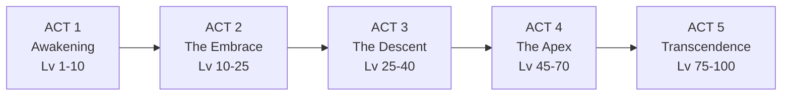

# MILLER: VOID RUN — Game Design Document
## Part 3 (K–O): Portal Worlds, Boss Runs, Characters, Story Beats, Missions

---

## K. PORTAL WORLDS

### Design Philosophy

Each portal world is adapted from the canon portal classification system (Green → Orange → Red → White). The 7 worlds progress through portal threat tiers, each with a distinct visual identity, obstacle palette, music mood, chaser beast, and a unique world mechanic that changes how the runner plays.

> [!NOTE]
> The canon defines portal types by beast-tier range, not by themed environments. All world names, visual themes, and unique mechanics are [NEW], built on the canon portal/beast framework.

---

### World 1 — Verdant Breach
**Portal Type:** Green (Basic to Advanced tier)

| Attribute | Detail |
|---|---|
| **Theme** | Overgrown ruins in a twilight forest — the "safe" training portal that Miller enters as an F-Rank |
| **Canon Basis** | "He starts his journey only entering green portals due to them being considered safe for lower rankers" |
| **Ground** | Cracked stone paths covered in luminous moss, exposed tree roots |
| **Skybox** | Perpetual twilight, floating islands in the distance, green-purple aurora |
| **Props** | Ancient stone altars, vine-choked arches, collapsed watchtowers, bioluminescent fungi |
| **Lighting** | Warm amber sunbeams cutting through canopy + void-purple rim light on edges |
| **Chaser** | Thornmaw (Advanced tier) — large quadruped, charges linearly, no abilities [NEW] |
| **Unique Mechanic** | **None** — this is the tutorial world; pure lane/jump/roll fundamentals |
| **Music Mood** | Mysterious, medium tempo, tribal percussion + ethereal synth pads |

**Obstacle Set:**

| Obstacle | Type | Frequency | Action |
|---|---|---|---|
| Fallen Tree Trunk | Ground | High | Jump |
| Root Tangle | Ground | Medium | Jump |
| Vine Canopy | Overhead | Medium | Roll |
| Stone Archway (low) | Overhead | Low | Roll |
| Void Fissure | Ground gap | Low | Jump |

---

### World 2 — Ember Corridor
**Portal Type:** Green/Orange boundary (Advanced to King tier)

| Attribute | Detail |
|---|---|
| **Theme** | Scorched industrial forge-works, rivers of molten material, collapsing metal structures |
| **Canon Basis** | Orange portals host up to Emperor tier; this world sits at the Green-Orange boundary |
| **Ground** | Blackened basalt with lava veins that pulse with light |
| **Skybox** | Smoke-choked crimson sky, distant volcanic eruptions, ember particle rain |
| **Props** | Ruined forge machinery, molten rivers (can't enter), cooling metal pillars, chain bridges |
| **Lighting** | Hot orange underlighting from lava + deep black shadows |
| **Chaser** | Skeld (King tier) — Shapeshifting beast; switches between fast-narrow and slow-wide forms every 300 m [NEW] |
| **Unique Mechanic** | **Lava Lanes** — one random lane becomes a lava lane for 5s intervals; stepping on it = stumble [NEW] |
| **Music Mood** | Industrial, driving beat, heavy percussion + distorted synth bass |

**Obstacle Set:**

| Obstacle | Type | Frequency | Action |
|---|---|---|---|
| Molten Rubble | Ground | High | Jump |
| Collapsed Girder | Overhead | High | Roll |
| Swinging Chain | Moving | Medium | Time passage |
| Steam Vent | Ground (timed) | Medium | Avoid lane during vent (1.5s) |
| Lava Pool | Lane hazard | Low | Switch lanes |

---

### World 3 — Obsidian Rift
**Portal Type:** Orange (Advanced to Emperor tier)

| Attribute | Detail |
|---|---|
| **Theme** | Shattered obsidian landscape, mirror-like surfaces, reality distortions — a world of illusions |
| **Canon Basis** | Emperor tier beasts have Illusion Casting, Mental Domination, Telempathy |
| **Ground** | Black glass with reflections that don't match reality |
| **Skybox** | Starless void, floating obsidian shards rotating slowly |
| **Props** | Crystal towers, refraction beams splitting light into void-colours, mirror pillars |
| **Lighting** | Cool blue point-lights from crystals + sharp void-white reflections |
| **Chaser** | Dreadwhisper (Emperor tier) — projects fake obstacles (70% opacity, ghostly shimmer) and emits fear pulse at Close range [NEW] |
| **Unique Mechanic** | **Illusion Obstacles** — 25% of visible obstacles are fakes (dodge them or run through; running through fakes grants +5 VE). Void Sense ability highlights which are real. [ADAPTED from Emperor beast Illusion Casting] |
| **Music Mood** | Unsettling, detuned piano + reversed audio samples + subtle heartbeat pulse |

**Obstacle Set:**

| Obstacle | Type | Frequency | Action |
|---|---|---|---|
| Crystal Spike | Ground | High | Jump |
| Refraction Beam | Overhead | Medium | Roll |
| Mirror Shard (rotating) | Moving | Medium | Time lane change |
| Illusion Obstacle | Fake (any type) | 25% of all spawns | Run through (reward) or dodge (safe) |
| Mind Pulse Zone | Area hazard | Low | Exit zone within 2s or controls invert for 0.5s |

---

### World 4 — Crimson Depths
**Portal Type:** Orange/Red boundary (King to Legendary tier)

| Attribute | Detail |
|---|---|
| **Theme** | Blood-red caverns, pulsing organic walls, Crimson Hand faction territory |
| **Canon Basis** | Crimson Hand Guild — Shawn Tami (Blood Captain, Necromancer), Ashley Moses (Huntress, Emotion Pulse) |
| **Ground** | Dark red stone with vein-like cracks pulsing with light |
| **Skybox** | Enclosed cavern ceiling with crimson fog, distant Crimson Hand banners |
| **Props** | Bone-like formations (stylised, not gory), faction banners, cage structures, weapon racks |
| **Lighting** | Deep saturated red + black shadows, occasional spotlight from above |
| **Chaser** | Pyreclad (Legendary tier) — Pyrokinesis: drops fire patches in lanes (3s duration), fires cross-lane projectiles every 15s [NEW] |
| **Unique Mechanic** | **Fire Trail** — the chaser leaves burning patches in one lane; patches persist for 3s, so the player must track which lanes are safe. At Close range, two lanes burn simultaneously. [ADAPTED from Legendary tier Pyrokinesis] |
| **Music Mood** | Aggressive, war drums + distorted guitar riffs + chanting |

**Obstacle Set:**

| Obstacle | Type | Frequency | Action |
|---|---|---|---|
| Bone Arch (low) | Overhead | High | Roll |
| Crimson Rubble | Ground | High | Jump |
| Fire Patch (from chaser) | Lane hazard | Per chaser rules | Switch lanes |
| Fireball Projectile | Moving | Every 15s | Lane change |
| Cage Swing | Moving | Medium | Time passage |
| Faction Soldier | Moving (boss lead-up) | Low (Pressure phase only) | Lane change or jump |

---

### World 5 — Frozen Archive
**Portal Type:** Red (King to Demon tier)

| Attribute | Detail |
|---|---|
| **Theme** | A frozen library beyond time — ice-locked knowledge vaults, temporal anomalies |
| **Canon Basis** | Demigod tier beasts have Time Manipulation, Gravity Manipulation; Takue Vesta's Time Anchor ability |
| **Ground** | Ice-blue crystal platforms, frost patterns that form and dissolve |
| **Skybox** | Aurora borealis over frozen sky, snowfall with void-purple tint |
| **Props** | Frozen bookshelves, time-locked scroll cases, shattered hourglasses, ice pillars |
| **Lighting** | Ice-white ambient + void-purple accent lighting from frozen Codex pages |
| **Chaser** | Chronal Wyrm (Demigod tier) — Time Manipulation: creates slow-time zones; Gravity Manipulation: tilts collectible and player drift [NEW] |
| **Unique Mechanic** | **Ice Physics** — lane changes have 100 ms extra slide (momentum carries). Slide/roll lasts 20% longer due to ice. Time Bleed ability is 30% more effective in this world. [NEW] |
| **Music Mood** | Crystalline, music-box melodies + deep sub-bass + time-stretched reverb |

**Obstacle Set:**

| Obstacle | Type | Frequency | Action |
|---|---|---|---|
| Ice Pillar | Ground | High | Jump |
| Frozen Archway | Overhead | High | Roll |
| Time-Slow Zone (from chaser) | Area hazard | Every 20s | Avoid zone or accept 30% speed loss for 2s |
| Gravity Drift | Lane hazard | Every 25s | Counter-steer (swipe against drift) |
| Cracking Ice | Ground (timed) | Medium | Jump before ice breaks (1.5s telegraph) |
| Frozen Scroll Case | Ground | Low | Jump (but drops Codex Fragment if destroyed with power) |

---

### World 6 — Abyssal Maw
**Portal Type:** Red/White boundary (Demon to Yigyang tier)

| Attribute | Detail |
|---|---|
| **Theme** | The edge of the void itself — floating debris in an endless dark abyss, tendrils of void energy everywhere |
| **Canon Basis** | Demon tier beasts: Summoning, Life Force Drain; "Abyssal beasts can use void infestation to infect other lesser beasts" |
| **Ground** | Void-black terrain, floating rock platforms connected by void-energy bridges |
| **Skybox** | Pure void — no sky, no stars, only distant void-light pulses |
| **Props** | Teeth-like rock formations, writhing void tendrils, floating beast carcasses, corrupted portal fragments |
| **Lighting** | Void-purple rim lighting on all edges + neon accent glows (cyan, magenta) |
| **Chaser** | Voidstalker (Demon tier) — Summoning: spawns minion waves every 25s; Life Force Drain: drains shards at Close range [NEW] |
| **Unique Mechanic** | **Void Infestation Zones** — patches of void-infested ground appear; running through them spawns a parasite that attaches to Miller for 5s, reducing VE regen to 0. Cleansed by using any Void Power. [ADAPTED from Abyssal trait "Void Infestation"] |
| **Music Mood** | Dread ambient + deep drone + sporadic screeches + heavy reverb percussion |

**Obstacle Set:**

| Obstacle | Type | Frequency | Action |
|---|---|---|---|
| Void Tendril | Overhead / Ground | High | Jump or roll depending on height |
| Floating Debris | Ground | High | Jump |
| Summoned Minion (from chaser) | Moving | Waves of 2–3 every 25s | Lane change to avoid |
| Void Infestation Patch | Lane hazard | 1 per 150 m | Switch lanes |
| Collapsing Platform | Ground (timed) | Medium | Don't linger (platform falls after 1s) |
| Void Geyser | Ground (timed) | Medium | 1.5s telegraph, erupts for 0.5s |

---

### World 7 — The Terminus
**Portal Type:** White (Yigyang to Abyssal tier)

| Attribute | Detail |
|---|---|
| **Theme** | The end of all portals — reality itself is fragmenting. Pieces of every previous world appear and dissolve. This is where Tay Sonder's influence reaches. |
| **Canon Basis** | White portals: Demon to Abyssal tier; Tay Sonder as World Leader; Yigyang tier abilities |
| **Ground** | Fracturing reality tiles — patches of all previous world textures shifting and swapping |
| **Skybox** | Kaleidoscopic void, all previous skyboxes blending and tearing |
| **Props** | Fragments of all 6 previous worlds materialising and dissolving, Dominion Authority sigils |
| **Lighting** | Unstable — shifts between all previous world palettes every 10s |
| **Chaser** | Null Sovereign (Yigyang tier) — Intangibility: phases through obstacles; Dark Veil: blackout screen; Sonic Wave: full-width projectile [NEW] |
| **Unique Mechanic** | **Reality Shift** — every 10s the world's visual theme and obstacle set randomly shifts to one of the previous 6 worlds for 8s, bringing that world's unique mechanic with it (lava lanes, illusions, ice physics, etc.). Players must adapt instantly. [NEW] |
| **Music Mood** | All previous tracks layered and crossfading chaotically + ascending void choir |

**Obstacle Set:**

| Obstacle | Type | Frequency | Action |
|---|---|---|---|
| All previous obstacles | Mixed | High | All previous actions |
| Sonic Wave (from chaser) | Full-width projectile | Every 20s | Jump or roll (alternates height) |
| Dark Veil Blackout | Screen hazard | Every 30s, 1.5s duration | Navigate by void-glow only |
| Reality Fracture | Ground gap (wide) | Medium | Jump + pray |
| Dominion Barrier | 2-lane blocker | Low | Forced lane choice — wrong side has chaser burst |

---

### World Summary Table

| # | World | Portal | Chaser (Tier) | Unique Mechanic | Difficulty |
|---|---|---|---|---|---|
| 1 | Verdant Breach | Green | Thornmaw (Advanced) | None — tutorial | ★☆☆☆☆ |
| 2 | Ember Corridor | Green/Orange | Skeld (King) | Lava Lanes | ★★☆☆☆ |
| 3 | Obsidian Rift | Orange | Dreadwhisper (Emperor) | Illusion Obstacles | ★★★☆☆ |
| 4 | Crimson Depths | Orange/Red | Pyreclad (Legendary) | Fire Trail | ★★★☆☆ |
| 5 | Frozen Archive | Red | Chronal Wyrm (Demigod) | Ice Physics + Time Zones | ★★★★☆ |
| 6 | Abyssal Maw | Red/White | Voidstalker (Demon) | Void Infestation Zones | ★★★★☆ |
| 7 | The Terminus | White | Null Sovereign (Yigyang) | Reality Shift | ★★★★★ |

### World Unlock & Asset Pack Structure [NEW]

| World | Unlock Condition | Delivery |
|---|---|---|
| 1 — Verdant Breach | Available at start | Base APK |
| 2 — Ember Corridor | Reach 1,400 m in World 1 OR Codex Lv 5 | Base APK |
| 3 — Obsidian Rift | Reach 1,400 m in World 2 OR Codex Lv 12 | Asset Pack 1 (~25 MB) |
| 4 — Crimson Depths | Reach 1,400 m in World 3 OR Codex Lv 20 | Asset Pack 1 |
| 5 — Frozen Archive | Reach 1,400 m in World 4 OR Codex Lv 30 | Asset Pack 2 (~25 MB) |
| 6 — Abyssal Maw | Reach 1,400 m in World 5 OR Codex Lv 45 | Asset Pack 2 |
| 7 — The Terminus | Reach 1,400 m in World 6 OR Codex Lv 65 | Asset Pack 3 (~20 MB) |

---

## L. BOSS RUNS

### Design Philosophy

Every portal world ends with a **Boss Chase** — a scripted 400 m sequence where the standard chaser pauses and a named faction antagonist takes over. Boss runs are patterned encounters (not pure random generation) with memorisable phases and a climactic escape moment designed for shareability.

> [!IMPORTANT]
> Bosses are canon characters from the antagonist factions. Their abilities are drawn directly from the story document.

---

### L.1 · World 1 Boss — Alton Dam (Obscura Guild)
**Canon:** "Part of the Obscura Guild, second best Hunter. Density Shift — can increase (super-heavy/durable) or decrease (intangibility/phasing) density to self and objects."

| Phase | Distance | Mechanic | Player Action |
|---|---|---|---|
| **Phase 1: The Chase** | 1400–1550 m | Alton runs alongside on a parallel path, throwing density-shifted boulders (super-heavy, slow-moving, 1 lane each) | Dodge boulders — they're slow but block the lane for 2s after landing |
| **Phase 2: Density Wall** | 1550–1700 m | Alton phases through the track and creates density walls across 2 lanes, alternating sides every 4s | React to which lane stays open — walls telegraph with ground cracks 1.5s before |
| **Phase 3: Escape** | 1700–1800 m | Alton goes intangible and charges directly at Miller from ahead. Scripted moment: Miller must use a Void Power or hit a Void Surge pickup to blast through Alton's phased form. | **Scripted QTE:** Void Button prompt appears — tap within 1.5s window. Success = void blast sends Alton flying, portal transition. Failure = stumble + chaser catches up → potential game over. |

**Escape Moment Visual:** Miller's void power collides with Alton's density field — shockwave explosion, slow-motion, Alton tumbles into the collapsing portal behind. Auto-captured as shareable clip.

---

### L.2 · World 2 Boss — James Stole (Obscura Tracker)
**Canon:** "He is a tracker, a top player in his field. Earth — manipulate earth shaping with zone-specific enhancement."

| Phase | Distance | Mechanic | Player Action |
|---|---|---|---|
| **Phase 1: Earth Spikes** | 1400–1550 m | Stole raises earth spikes from the ground in rapid succession across lanes — they erupt with a 1s rumble telegraph | Read the ground rumble patterns and dodge — spikes come in 3-spike bursts with 2s gaps |
| **Phase 2: Earthen Tunnel** | 1550–1700 m | Stole reshapes the track into a narrow tunnel — walls close in, reducing to 2 lanes, then 1 lane, then back to 3 | Navigate shrinking/expanding lanes; overhead obstacles appear in tight sections |
| **Phase 3: Escape** | 1700–1800 m | Stole creates a massive earth wall blocking all 3 lanes. The ground beneath Miller rises into a ramp. | **Jump ramp → scripted moment:** Miller launches off the ramp over the wall. Swipe Up at the peak for maximum distance. Stole's wall crumbles as the portal collapses. |

**Escape Moment Visual:** Dramatic ramp launch, slow-motion aerial, Miller silhouetted against the portal, earth wall shatters below.

---

### L.3 · World 3 Boss — Felix Torrot (Obscura Guild)
**Canon:** "The temporal specialist guarding the Echo-Fragment in the Temporal Anchor Magneto-flux core."

| Phase | Distance | Mechanic | Player Action |
|---|---|---|---|
| **Phase 1: Time Stutter** | 1400–1550 m | Felix creates temporal stutters — the game freezes for 0.3s then resumes at 1.5× speed for 2s, repeating every 5s | Anticipate the speed change; react faster during bursts |
| **Phase 2: Echo Clones** | 1550–1700 m | Felix sends temporal echo-clones running backward toward Miller — they occupy lanes like obstacles but flicker in/out | Dodge clones; they appear translucent 1s before becoming solid for 0.5s |
| **Phase 3: Escape** | 1700–1800 m | Felix anchors time — the entire world slows except Miller and Felix. Felix charges from the side. | **Scripted:** Time Bleed auto-activates (even if not equipped). Miller outruns Felix in slow-time, reaches the portal edge. Final swipe to leap through as time snaps back. |

**Escape Moment Visual:** World in extreme slow-motion, Miller sprinting in real-time through frozen obstacles, Felix's echo-clones shattering like glass as Miller passes them.

---

### L.4 · World 4 Boss — Shawn Tami (Crimson Hand — Blood Captain)
**Canon:** "A brutal combat-focused Guild Leader (The Crimson Hand Guild) who believes power is meant to be displayed not hidden. Necromancer."

| Phase | Distance | Mechanic | Player Action |
|---|---|---|---|
| **Phase 1: Undead Horde** | 1400–1550 m | Shawn raises undead beasts from the ground — they shamble toward Miller from all 3 lanes in staggered waves | Weave between shambling undead; they move slowly but fill lanes in groups of 2–3 |
| **Phase 2: Necro Storm** | 1550–1700 m | Shawn channels a dark energy storm — purple-black lightning strikes random lanes with a 1s skull-flash telegraph, plus undead continue in lighter waves | Dodge lightning (lane change) while navigating remaining undead |
| **Phase 3: Escape** | 1700–1800 m | Shawn teleports directly in front of Miller and raises a wall of undead across all 3 lanes | **Scripted:** Void Power prompt. Miller unleashes a void blast that disintegrates the undead wall. If Shadow Shield is equipped, it auto-activates for a dramatic barrier-vs-horde collision. |

**Escape Moment Visual:** Miller's void energy ripples outward, undead disintegrate into void particles, Shawn is blasted backward screaming, portal collapses in a Crimson Hand banner-tearing explosion.

---

### L.5 · World 5 Boss — Sil Talen (Veridian Accord — Bio-Forger)
**Canon:** "Part of the Veridian Accord, a scientist. Living Tissue Manipulation. Sees Miller as the ultimate evolutionary catalyst."

| Phase | Distance | Mechanic | Player Action |
|---|---|---|---|
| **Phase 1: Bio Growth** | 1400–1550 m | Sil causes organic tissue to grow across the track — tentacle-like growths emerge from walls and floor, pulsing and reaching | Jump/roll through organic obstacles; they retract after 2s and regrow elsewhere |
| **Phase 2: Evolution Wave** | 1550–1700 m | Sil sends waves of mutagenic energy along the ground — green-tinted wave across all lanes that must be jumped over. After each wave, existing obstacles mutate (grow taller/wider) | Jump waves (every 6s), navigate mutated larger obstacles |
| **Phase 3: Escape** | 1700–1800 m | Sil creates a bio-construct beast that fills the entire track behind Miller, consuming the track itself | **Scripted sprint:** Track speed increases to 2× for 5s. Miller must dodge a final gauntlet of organic arches and tendrils. At the portal edge, Miller leaps and uses Erasure Wave/Void Power to sever Sil's bio-construct. |

**Escape Moment Visual:** Massive organic beast crumbling behind Miller, void energy slicing through tissue, slow-motion leap through the portal as bio-mass collapses into the void.

---

### L.6 · World 6 Boss — Ashley Moses (Crimson Hand — Huntress)
**Canon:** "Enhanced tracking, specializes in hunting portal beasts, Shawn's second-in-command. Emotion Pulse."

| Phase | Distance | Mechanic | Player Action |
|---|---|---|---|
| **Phase 1: Hunter's Pursuit** | 1400–1550 m | Ashley is a precision pursuer — she runs behind Miller and fires tracking darts (homing projectiles that follow Miller's lane with 1.5s delay) | Switch lanes after dart fires; dart follows old position |
| **Phase 2: Emotion Pulse** | 1550–1700 m | Ashley activates Emotion Pulse — fear waves ripple outward; screen edges pulse red; controls momentarily become sluggish (200 ms added input delay) for 2s every 8s | Power through sluggish controls, use Void Powers during fear windows for immunity |
| **Phase 3: Escape** | 1700–1800 m | Ashley goes all-out — darts + fear pulses simultaneously. She leaps to the track ahead for a face-to-face standoff. | **Scripted:** Ashley blocks the path. Three rapid swipe prompts (Left, Right, Up) to dodge her melee attacks. Success = Miller slides under her final strike and escapes through the portal. |

**Escape Moment Visual:** Ashley's frustrated Emotion Pulse backfires as Miller's void aura absorbs it, slow-motion slide under her blade, portal collapses between them.

---

### L.7 · World 7 Final Boss — Tay Sonder (World Leader)
**Canon:** "The World Leader. Dual Tether — splits his being into perfect twin-clone each holding different ability such as Body-weaponization or Adaptation. Has 5 Elite Hunters at S-rank always by his side."

> [!IMPORTANT]
> This is the climactic boss encounter. It is longer (600 m instead of 400 m) and has 4 phases instead of 3.

| Phase | Distance | Mechanic | Player Action |
|---|---|---|---|
| **Phase 1: Elite Guard** | 1400–1600 m | Tay Sonder's 5 S-Rank Elite Hunters appear as obstacles — each one blocks a lane and attacks with a unique pattern (sword sweep = roll, spear thrust = jump, shield wall = lane change). They cycle every 4s. | Read each Elite's attack type and respond correctly |
| **Phase 2: Dual Tether** | 1600–1750 m | Tay splits into twin-clones. Clone A (Body-Weaponization) runs on the left creating blade-arm sweeps across lanes. Clone B (Adaptation) runs on the right and mirrors Miller's lane changes with a 1s delay, throwing adapted attacks. | Dodge Clone A's sweeps (they telegraph with arm transformations) while keeping Clone B from locking onto your lane (keep switching) |
| **Phase 3: Combined Assault** | 1750–1900 m | The twins recombine. Tay Sonder attacks with both powers simultaneously — blade sweeps + adaptive homing. Speed reaches maximum (20 m/s). Track is The Terminus at peak reality-fracture. | The hardest gameplay sequence in the game. Pure survival. |
| **Phase 4: Escape — Void Eruption** | 1900–2000 m | **Scripted cinematic sequence.** Tay Sonder charges his ultimate attack. Miller's Codex surges. Regardless of equipped power, Miller channels a massive Void Eruption. | **Single Void Button press** at the climactic moment (3s window, very forgiving). Miller unleashes the Void Eruption, shattering Tay Sonder's Dual Tether and collapsing The Terminus. |

**Escape Moment Visual:** The screen-filling moment of the entire game. Miller glows with full Codex energy. Void eruption expands in all directions. Tay Sonder's twin-clones are ripped apart and hurled into the void. The Terminus fractures into shards of every world. Slow-motion, void choir peaks, screen goes white, then black. Title card: "VOID RUN COMPLETE." Auto-captured as shareable clip.

---

### Boss Difficulty Tuning [NEW]

| Boss | QTE Window | Phase Speed | Forgiveness | Recommended Codex Lv |
|---|---|---|---|---|
| Alton Dam | 1.5s | 1.4× base | High — 2 stumbles OK before fail | 5+ |
| James Stole | 1.3s | 1.45× | High | 10+ |
| Felix Torrot | 1.2s | 1.5× | Medium — 1 stumble OK | 18+ |
| Shawn Tami | 1.2s | 1.55× | Medium | 25+ |
| Sil Talen | 1.0s | 1.6× | Medium — tight | 35+ |
| Ashley Moses | 1.0s | 1.65× | Low — precise inputs needed | 50+ |
| Tay Sonder | 3.0s (cinematic) | 1.7× (phase 3: 1.85×) | Phase 4 is very forgiving (spectacle) | 70+ |

---

## M. CHARACTERS

### Design Philosophy

Miller is the default runner. 6 additional characters are unlocked through progression — each drawn from Miller's allies in the story. Every ally has:
- A **passive ability** that is always active during runs (adapted from their canon power)
- A **signature Void Power** that replaces one of Miller's equip slots (adapted or new)
- Unique running/jump/slide animations and a distinct visual silhouette [NEW]

> [!NOTE]
> Characters do NOT have different stats (speed, HP). Gameplay differentiation comes entirely from the passive + signature power. This keeps balance simple.

---

### M.1 · Miller Redwolf (Default)
**Canon Role:** Protagonist, F-Rank hunter, Umbral Codex bearer

| Attribute | Detail |
|---|---|
| **Passive** | **Codex Bearer** — Earns 10% bonus Codex XP from all sources |
| **Signature Power** | Full access to all 15 Void Powers (see Part 2) |
| **Visual** | Dark hoodie, Guild card clipped to belt (glows with F-rank insignia), Codex runes appear on arms when using powers |
| **Silhouette** | Lean, medium height, hood up — instantly readable |
| **Unlock** | Available at start |

---

### M.2 · Leonard Meleak
**Canon Role:** "Miller's loyal best friend, C-Rank hunter. Power Mimicry — copying powers observed in others through physical touch."

| Attribute | Detail |
|---|---|
| **Passive** | **Power Echo** — When Miller (in a previous run) used a Void Power, Leonard's next run starts with that power's cooldown reduced by 50%. [ADAPTED from Power Mimicry — he "copies" what he saw Miller do] |
| **Signature Power** | **Mimicry Surge** [ADAPTED] — Copies the last power-up collected and re-activates it for 3s. If no power-up collected yet, generates a random one. CD: 20s, VE: 25 |
| **Visual** | Casual tech-wear, earphones around neck, phone holstered on arm (his love of electronics), confident stride |
| **Silhouette** | Slightly stockier than Miller, earphones visible |
| **Unlock** | 1,500 VS + 3 Beast Cores + Codex Lv 10 |

---

### M.3 · Precious Trisky
**Canon Role:** "Healer, works at the Military clinic. Thread Manipulation (Healing). Large amount of MP."

| Attribute | Detail |
|---|---|
| **Passive** | **Healer's Thread** — After a stumble, recovery time is 30% faster (300 ms → 210 ms). Additionally, VE regenerates 25% faster at all times. [ADAPTED from healing + high MP] |
| **Signature Power** | **Thread Mend** [ADAPTED] — Instantly removes stumble state and grants 2s of hit immunity. If not stumbling, creates a healing aura that grants +50% VE regen for 5s. CD: 15s, VE: 20 |
| **Visual** | Military medic outfit with glowing thread patterns on gloves, first-aid cross with void-purple tint |
| **Silhouette** | Ponytail, medic cross visible on back |
| **Unlock** | 2,500 VS + 4 Beast Cores + Codex Lv 15 |

---

### M.4 · Rumbidzai Mash (The Phantom Blade)
**Canon Role:** "Leader of the secret assassins' faction 'Elytra', known as the Phantom Blade. Intangible Weapon Summoning. Best at stealth assassination."

| Attribute | Detail |
|---|---|
| **Passive** | **Phantom Step** — All lane changes are 30% faster (200 ms → 140 ms), and the first obstacle of every run is automatically phased through. [ADAPTED from stealth + intangibility] |
| **Signature Power** | **Blade Phase** [ADAPTED] — Summons intangible blades that destroy the nearest 3 obstacles in any lane ahead (12 m range) and grants 1s of full intangibility. CD: 12s, VE: 30 |
| **Visual** | Dark stealth outfit, mask that partially covers face, faint blade silhouettes orbiting wrists |
| **Silhouette** | Slim, agile stance, mask and blade trails distinctive |
| **Unlock** | 3,000 VS + 5 Beast Cores + Codex Lv 20 |

---

### M.5 · Harry Koera
**Canon Role:** "Teacher at the Military, more of a detective. Ritual Magic — performing complex ceremonies for powerful effects. Assigned to taking students to train in green portals."

| Attribute | Detail |
|---|---|
| **Passive** | **Detective's Instinct** — Rare collectibles (Beast Cores, Codex Fragments) have a 25% increased spawn chance. Hidden paths are always visible without Void Sense. [ADAPTED from his investigative nature] |
| **Signature Power** | **Ritual Ward** [ADAPTED] — Places a ritual circle on the ground that lasts 8s; any obstacle that enters the circle's lane is destroyed. Functions as a "set and forget" lane cleaner. CD: 22s, VE: 35 |
| **Visual** | Teacher's coat over tactical gear, magnifying glass on belt chain, ritual circle patterns on coat back |
| **Silhouette** | Taller, coat tails flap during run |
| **Unlock** | 4,000 VS + 7 Beast Cores + Codex Lv 30 |

---

### M.6 · Garfield Thorn
**Canon Role:** "A young sentinel with rare ability. Energy Conversion + Object Duplication. Scout and messenger, traverses dangerous territories."

| Attribute | Detail |
|---|---|
| **Passive** | **Energy Convert** — Every obstacle destroyed (by any power) converts into 3 Void Shards. [ADAPTED from Energy Conversion] |
| **Signature Power** | **Duplicate Burst** [ADAPTED] — Duplicates the last collected power-up and activates both simultaneously. If no power-up was collected, duplicates the nearest collectible cluster (2× shards). CD: 25s, VE: 30 |
| **Visual** | Scout uniform with energy-crackling gloves, messenger bag, eager posture (leans forward while running) |
| **Silhouette** | Youngest-looking, smaller frame, bag strap visible |
| **Unlock** | 6,000 VS + 10 Beast Cores + Codex Lv 45 |

---

### M.7 · Ruth Swait
**Canon Role:** "Guild Architect, member of the Obscura Guild. Cryokinesis. Journalist as cover. Ended up joining Miller's group."

| Attribute | Detail |
|---|---|
| **Passive** | **Frost Architect** — Overhead obstacles shatter on contact (auto-cleared) instead of causing stumble. Only overhead — ground and moving obstacles still hit normally. [ADAPTED from Cryokinesis + Architect — she freezes and shatters barriers] |
| **Signature Power** | **Cryo Path** [ADAPTED] — Freezes the entire track for 4s. All obstacles become brittle ice — running into them shatters them (no stumble) and each shatter drops 2 Void Shards. CD: 20s, VE: 40 |
| **Visual** | Journalist outfit layered over Obscura guild markings (subtle), frost crystals on fingertips, ice-blue highlights in hair |
| **Silhouette** | Medium height, notable hair volume, frost particle trail |
| **Unlock** | 8,000 VS + 15 Beast Cores + Codex Lv 60 |

---

### Character Summary Table

| # | Character | Canon Power | Passive [ADAPTED] | Signature [ADAPTED] | Unlock Lv |
|---|---|---|---|---|---|
| 1 | Miller Redwolf | Umbral Codex | +10% XP | All 15 Void Powers | Start |
| 2 | Leonard Meleak | Power Mimicry | Cooldown echo from Miller's last run | Mimicry Surge | 10 |
| 3 | Precious Trisky | Thread Manipulation | Faster recovery + VE regen | Thread Mend | 15 |
| 4 | Rumbidzai Mash | Intangible Weapons | Faster lane change + first phase-through | Blade Phase | 20 |
| 5 | Harry Koera | Ritual Magic | Rare item boost + hidden path reveal | Ritual Ward | 30 |
| 6 | Garfield Thorn | Energy Conversion | Obstacles → Shards on destroy | Duplicate Burst | 45 |
| 7 | Ruth Swait | Cryokinesis | Auto-clear overhead obstacles | Cryo Path | 60 |

---

## N. STORY DELIVERY

### Format
- **Comic-panel cutscenes** — 3–5 panels per scene, illustrated in the game's stylised art, with brief dialogue bubbles (≤15 words per bubble)
- **No long text walls** — story is delivered visually, never pausing gameplay for more than 12 seconds
- **Voice barks** — short voiced lines during runs ("He's gaining on us!" / "The Codex is reacting!") [NEW]
- **Codex Journal** — unlockable lore entries in the menu, for players who want deeper story [NEW]

### Story Structure — 5 Acts (1 per Codex Stage)



---

#### Act 1 — Awakening (Worlds 1–2)
**Theme:** The nobody becomes something

| Beat | Trigger | Scene (3–5 panels) | Canon Basis |
|---|---|---|---|
| 1.1 — The Key | First run | Miller finds the mysterious key. Enters the dungeon portal. The Codex awakens. | "He acquires the system when he got a mysterious key that can open a dungeon" |
| 1.2 — First Beast | Complete World 1 | Miller barely survives the Advanced-tier beast. The Codex levels up. Leonard appears, impressed but suspicious. | "He was attacked by an advanced tier beast leading to critical danger" |
| 1.3 — The Secret | Codex Lv 5 | Miller hides the Codex interface from Leonard. His F-Rank guild card glows faintly. | "He must keep the system a secret from everyone" |
| 1.4 — Ember Trial | Complete World 2 | Miller enters an Orange portal for the first time. Faces a King-tier beast. Leonard insists on coming along. | "He is a C-Rank hunter but always chooses to go with Miller in green portals" |

#### Act 2 — The Embrace (Worlds 2–3)
**Theme:** Allies gather, enemies notice

| Beat | Trigger | Scene | Canon Basis |
|---|---|---|---|
| 2.1 — The Healer | Codex Lv 12 | Precious Trisky patches up Miller after a rough run. She notices his injuries heal unusually fast. | Canon: "She treats most his injuries" |
| 2.2 — Phantom Contact | Codex Lv 16 | Rumbidzai Mash appears as a "school girl in drama class." She watches Miller with unusual interest. | Canon: "She introduced herself as a school girl in drama class" |
| 2.3 — Obscura Eyes | Codex Lv 20 | Alton Dam discovers Miller has Beast Cores. He concludes Miller stole them. The hunt begins. | Canon: "He finds out that Miller has 3 Advanced-tier beast cores and 1 King-tier" |
| 2.4 — The Obsidian Rift | Complete World 3 | Miller enters an illusion-filled portal. The Codex reveals its second stage. | ADAPTED |

#### Act 3 — The Descent (Worlds 4–5)
**Theme:** Factions close in, Miller descends deeper

| Beat | Trigger | Scene | Canon Basis |
|---|---|---|---|
| 3.1 — Crimson Hand | Codex Lv 25 | Shawn Tami declares Miller is "a weapon to claim or a rival to crush." Ashley Moses is dispatched. | Canon: Shawn Tami's characterisation |
| 3.2 — The Veridian Interest | Codex Lv 30 | Sil Talen observes Miller from a distance. "The ultimate evolutionary catalyst." | Canon: Sil Talen's characterisation |
| 3.3 — Beast Core Awakening | Codex Lv 30 (ability unlock) | Miller absorbs a beast core for the first time. New ability manifests. The Codex evolves. | Canon: "At Level 30 he unlocked Beast Core ability Harnessing" |
| 3.4 — Ruth's Gambit | Codex Lv 35 | Ruth Swait approaches Miller as a journalist. Her Obscura loyalties are hidden. | Canon: "She acts as a journalist as a cover up job" |

#### Act 4 — The Apex (Worlds 5–6)
**Theme:** Miller becomes a true power, Tay Sonder takes notice

| Beat | Trigger | Scene | Canon Basis |
|---|---|---|---|
| 4.1 — The Dominion Watches | Codex Lv 45 | Wayne Chang files a report on Miller. Tay Sonder reads it. "Anyone with power is a threat." | Canon: Wayne Chang + Tay Sonder characterisation |
| 4.2 — Allies Unite | Codex Lv 50 | Leonard, Precious, Rumbidzai, Harry gather. They know Miller is hiding something. Tension and trust. | ADAPTED — group dynamics from canon relationships |
| 4.3 — Ruth Defects | Codex Lv 55 | Ruth leaves the Obscura and joins Miller's group. Inter-group dynamics begin. | Canon: "She ended up being the one who joined Miller's group" |
| 4.4 — The Abyssal Gate | Complete World 6 | A White portal appears — something that shouldn't exist in this region. The Codex pulses. | ADAPTED |

#### Act 5 — Transcendence (World 7)
**Theme:** Final confrontation with Tay Sonder

| Beat | Trigger | Scene | Canon Basis |
|---|---|---|---|
| 5.1 — Tay Sonder's Challenge | Codex Lv 75 | Tay Sonder broadcasts: Miller is declared an enemy of the state. His 5 Elite Hunters are deployed. | Canon: "5 Elite hunters at S-rank always by his side" |
| 5.2 — The Terminus Opens | Enter World 7 | The final portal — a White portal that leads to the edge of reality itself. | ADAPTED |
| 5.3 — Dual Tether | Defeat Tay Sonder Phase 2 | Mid-boss cutscene: Tay Sonder splits via Dual Tether. Both clones speak simultaneously. | Canon: "Dual Tether — splits his being into perfect twin-clone" |
| 5.4 — Transcendence | Defeat Tay Sonder Phase 4 | Miller achieves Transcendence. The Codex is complete. Final scene: Miller stands in the void, all allies behind him, looking into a new portal. "This isn't the end. It's the awakening." | ADAPTED — open ending for future content |

---

## O. MISSIONS AND CHALLENGES

### O.1 · Per-Run Missions [NEW]
Active during every run. 3 randomly selected from the pool. Completing all 3 in one run grants a bonus reward.

| Mission | Example | Reward |
|---|---|---|
| Distance | "Run 1,200 m" | 50 VS |
| Collection | "Collect 200 Void Shards in one run" | 60 VS |
| Power Use | "Use Void Powers 5 times" | 40 VS |
| Near-Miss | "Achieve 15 near-misses" | 80 VS |
| No-Hit | "Run 500 m without hitting an obstacle" | 100 VS |
| Boss | "Survive the Boss Chase" | 1 Beast Core |
| **All 3 Completed Bonus** | — | +50 VS + 5 CE |

### O.2 · Daily Missions [NEW]
Reset every 24 hours. 3 missions per day.

| Mission Type | Example | Reward |
|---|---|---|
| Cumulative Distance | "Run a total of 5,000 m today" | 150 VS + 10 CE |
| Character Play | "Complete a run with Leonard" | 100 VS |
| World Play | "Enter the Obsidian Rift" | 120 VS + 1 Codex Fragment chance |
| Power Mastery | "Use Time Bleed 3 times across all runs" | 80 VS + 5 CE |
| Economy | "Spend 500 VS in the Shop" | 100 VS rebate |
| Social | "Share a clip or challenge a friend" | 50 VS |
| **Daily Completion (all 3)** | — | 200 VS + 15 CE + daily chest key |

### O.3 · Weekly Missions [NEW]
Reset every Monday. 5 missions per week, scaling difficulty.

| Mission | Reward | Difficulty |
|---|---|---|
| "Reach World 5 in a single session" | 500 VS + 2 BC | Hard |
| "Defeat 3 different bosses" | 400 VS + 20 CE | Medium |
| "Collect 5,000 Void Shards total" | 600 VS | Easy (cumulative) |
| "Achieve 100 near-misses total" | 300 VS + 1 BC | Medium |
| "Complete 20 runs" | 500 VS + 30 CE | Easy (time) |
| **Weekly Completion (all 5)** | 1,000 VS + 3 BC + Rare Skin Ticket | — |

### O.4 · Codex Milestone Track [ADAPTED from canon level-up system]

A permanent progression track tied to Codex Level — never resets, always progressing.

| Milestone | Codex Lv | Reward | Canon Tie |
|---|---|---|---|
| First Awakening | 1 | Flicker ability | Stage 1 start |
| System Online | 3 | Inventory (skin equip) | "Inventory unlocks at level 3" |
| Void Initiate | 5 | 500 VS + Void Sense upgrade | — |
| The Embrace Begins | 10 | Shop unlock + Shadow Shield | "Shop unlocks at Level 10" + Stage 2 |
| Leonard's Trust | 10 | Leonard character unlock available | — |
| Phantom's Gaze | 20 | Rumbidzai unlock available | — |
| The Descent | 25 | 2nd equip slot + Time Bleed | Stage 3 |
| Core Harnessing | 30 | Beast Core system unlocked | Canon: Lv 30 ability |
| The Apex | 45 | Passive slot + Void Domain | Stage 4 |
| World's Enemy | 65 | The Terminus world unlocked | — |
| Approaching Transcendence | 75 | Ultimate slot + Voidlight Synthesis | Stage 5 |
| God of Void | 100 | Transcendence Skin + Title + all abilities max | Final milestone |

### O.5 · Mission UI Summary [NEW]

```
┌─────────────────────────────────────────────┐
│              MISSION SCREEN                 │
├─────────────────────────────────────────────┤
│                                             │
│  ┌─ Per-Run (3 active) ──────────────────┐  │
│  │ ☐ Run 1,200 m            [50 VS]     │  │
│  │ ☐ 15 near-misses         [80 VS]     │  │
│  │ ☐ Use powers 5 times     [40 VS]     │  │
│  │        Bonus: Complete all → +50 VS   │  │
│  └───────────────────────────────────────┘  │
│                                             │
│  ┌─ Daily (3 of 3) ─────── 14:32 left ──┐  │
│  │ ☑ Run 5,000 m total      [150 VS] ✓  │  │
│  │ ☐ Play as Leonard        [100 VS]    │  │
│  │ ☐ Share a clip           [50 VS]     │  │
│  │        Bonus: Complete all → Chest    │  │
│  └───────────────────────────────────────┘  │
│                                             │
│  ┌─ Weekly (2 of 5) ────── 3 days left ─┐  │
│  │ ☑ Defeat 3 bosses   [400 VS+20CE] ✓  │  │
│  │ ☑ 100 near-misses   [300 VS+1BC]  ✓  │  │
│  │ ☐ Reach World 5     [500 VS+2BC]     │  │
│  │ ☐ 5,000 shards      [600 VS]         │  │
│  │ ☐ 20 runs           [500 VS+30CE]    │  │
│  └───────────────────────────────────────┘  │
│                                             │
│  ┌─ Codex Milestones ───────────────────┐  │
│  │ ████████████░░░░░░  Lv 23 / 25       │  │
│  │ Next: "The Descent" → 2nd equip slot │  │
│  └───────────────────────────────────────┘  │
│                                             │
└─────────────────────────────────────────────┘
```

---

## Canon Elements Referenced in Part 3

| Element | Source | Usage |
|---|---|---|
| Portal types (Green/Orange/Red/White) | Canon portal system | World tier mapping |
| Beast tier abilities (all tiers) | Canon beast hierarchy | World unique mechanics, chaser design |
| Alton Dam + Density Shift | Canon character | World 1 Boss |
| James Stole + Earth manipulation | Canon character | World 2 Boss |
| Felix Torrot + temporal specialist | Canon character | World 3 Boss |
| Shawn Tami + Necromancer | Canon character | World 4 Boss |
| Sil Talen + Living Tissue Manipulation | Canon character | World 5 Boss |
| Ashley Moses + Emotion Pulse | Canon character | World 6 Boss |
| Tay Sonder + Dual Tether + 5 Elites | Canon character | World 7 Final Boss |
| Leonard Meleak + Power Mimicry | Canon character | Unlockable runner |
| Precious Trisky + Thread Manipulation | Canon character | Unlockable runner |
| Rumbidzai Mash + Intangible Weapons | Canon character | Unlockable runner |
| Harry Koera + Ritual Magic | Canon character | Unlockable runner |
| Garfield Thorn + Energy Conversion | Canon character | Unlockable runner |
| Ruth Swait + Cryokinesis | Canon character | Unlockable runner |
| Miller's F-Rank / mysterious key / secret | Canon plot points | Story beats |
| Beast Core Harnessing at Lv 30 | Canon ability | Story beat + milestone |
| "Shop unlocks at Level 10" | Canon mechanic | Milestone |
| "Inventory unlocks at level 3" | Canon mechanic | Milestone |

| Element | Status |
|---|---|
| World names and visual themes | [NEW] |
| Boss phase-by-phase mechanics | [NEW] — based on canon character abilities |
| Scripted escape moments | [NEW] |
| Character passives and signature powers | [ADAPTED] from canon powers |
| All story beat dialogue | [NEW] — inspired by canon characterisations |
| Mission system (daily/weekly/per-run) | [NEW] |
| Codex Milestone track rewards | [ADAPTED] from canon level-up system |

---

> **End of Part 3 (K–O)**
>
> Type **"continue"** to receive **Part 4 (P–T): Virality Features, Monetization, UI/UX Screens, Art & Audio Direction**
