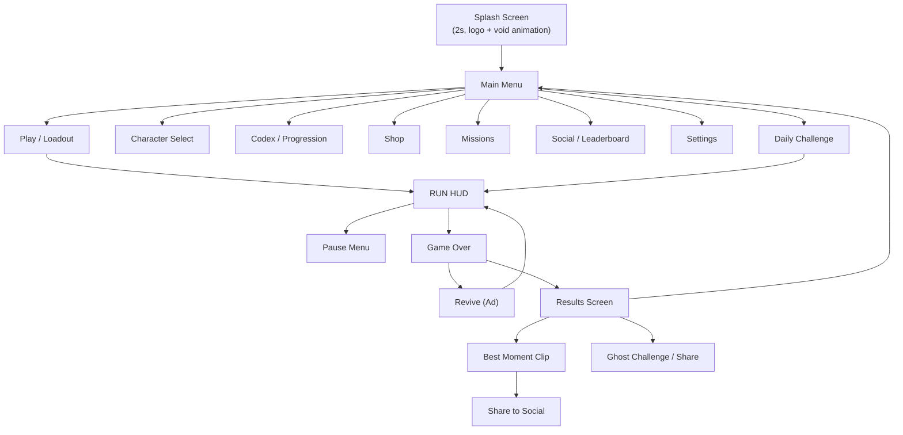
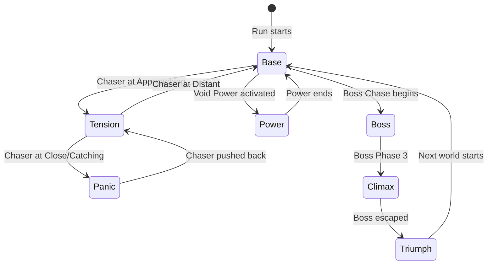

# MILLER: VOID RUN — Game Design Document
## Part 4 (P–T): Virality Features, Monetization, UI/UX Screens, Art & Audio Direction

---

## P. VIRALITY FEATURES [NEW]

### Design Philosophy

Every system is built around the question: *"Would a player screenshot, record, or share this?"* The goal is 1 shareable moment per run — whether that's a near-miss, a void power detonation, a boss escape, or a personal best.

---

### P.1 · One-Tap Clip Recording

| Feature | Detail |
|---|---|
| **System** | A rolling 15-second replay buffer records gameplay at all times |
| **Best Moment Detection** | The game scores moments in real-time based on a "hype score" system (see below). The highest-scoring moment per run is auto-bookmarked. |
| **Post-Run Share** | Results screen shows a "Watch Best Moment" button → plays the 5–8s clip with slow-mo and camera effects → "Share" button exports as MP4 to TikTok / Instagram / WhatsApp / X |
| **In-Run Manual** | Player can tap a small camera icon (top-left) to manually bookmark "right now" |
| **Format** | 720p MP4, portrait orientation, 5–8s duration, game watermark (MILLER: VOID RUN + distance) in bottom corner |

#### Hype Score System [NEW]

The game continuously calculates a hype score. Any frame where the score exceeds the threshold triggers a bookmark.

| Event | Hype Points | Decay |
|---|---|---|
| Near-miss (obstacle within 0.3 m) | +30 | −5/s |
| Double near-miss (<1s apart) | +60 | −5/s |
| Triple near-miss (<1.5s apart) | +100 | −5/s |
| Void Power activation | +20 | −3/s |
| Void Power hitting 3+ obstacles | +50 | −5/s |
| Time Bleed active + near-miss | +80 | −5/s |
| Chaser at Catching range + escape | +70 | −5/s |
| Boss phase transition | +40 | −3/s |
| Boss escape (scripted moment) | +100 | −5/s |
| Singularity Soul / Voidlight Synthesis | +90 | −5/s |
| Personal distance record broken | +60 | One-time |
| **Bookmark threshold** | **≥ 50** | — |

#### Clip Camera Effects [NEW]

When a bookmarked moment replays in the results screen, additional cinematic effects are applied:

| Hype Score | Camera Effect |
|---|---|
| 50–70 | Slight zoom on Miller, 0.8× speed for 1s |
| 70–90 | Dynamic zoom + chromatic aberration + 0.5× speed |
| 90+ | Full slow-mo (0.3×) + camera orbit + void particle burst + bass-drop SFX |

---

### P.2 · Ghost Challenge

| Feature | Detail |
|---|---|
| **Record** | Every run records Miller's lane position, jump/roll timing, and power usage as a lightweight data stream (~2 KB per run) |
| **Challenge a Friend** | Post-run → "Challenge" button → generates a share link / QR code |
| **Race** | Friend opens the link, loads the ghost data. Ghost Miller appears as a translucent purple silhouette on the same track (same seed). Both players see real-time position comparison. |
| **Result** | "You beat [Friend] by 142 m!" or "You lost! Try again?" → share result |
| **Data** | Ghost data stored locally + cloud sync (Firebase or equivalent). Challenge links valid for 7 days. |
| **Async** | No real-time networking required — ghost is a replay, not live |

---

### P.3 · Weekly Global Leaderboard

| Feature | Detail |
|---|---|
| **Metric** | Longest single-run distance (metres) |
| **Reset** | Every Monday 00:00 UTC |
| **Tiers** | Top 100 global + regional (country) + friends-only |
| **Rewards** | Top 10: exclusive weekly skin tint; Top 100: 500 VS; Top 1000: 200 VS |
| **Anti-Cheat** | Server-validated distance (run data hash sent with score; impossible speeds flagged) |
| **Share** | "I'm #47 worldwide this week!" → share card with player name, distance, character, world reached |

---

### P.4 · "Beat My Distance" Share Links

| Feature | Detail |
|---|---|
| **Trigger** | Post-run → "Beat This?" button |
| **Format** | Deep link: `voidrun://challenge?d=4832&u=MillerFan99&seed=...` |
| **Fallback** | If game not installed, link goes to Play Store page |
| **Display** | Recipient sees a challenge card: "[Player] ran 4,832 m. Can you beat it?" |
| **Completion** | After their run: "You ran 5,100 m — you WON!" or "You ran 3,200 m — try again!" → share result back |

---

### P.5 · Daily Challenge Seed

| Feature | Detail |
|---|---|
| **Concept** | Every day, one global seed generates the same track, same obstacle sequence, same power-up placements for everyone |
| **Entry** | "Daily Run" button on main menu (separate from normal runs) |
| **Leaderboard** | Daily-only leaderboard; resets at midnight UTC |
| **Rules** | 1 attempt per day (no revives, no continues) — pure skill |
| **Reward** | Participation: 50 VS. Top 10%: 200 VS + 10 CE. #1: 500 VS + unique daily badge |
| **Share** | "Today's Daily: 6,201 m — #142 worldwide" → share card |

---

### P.6 · Near-Miss & Combo Slow-Motion Highlights

| Feature | Detail |
|---|---|
| **Trigger** | Any obstacle missed by < 0.3 m (see hitbox forgiveness in Part 1) |
| **In-Game Effect** | Brief 0.7× speed for 0.4s, screen-edge void flash, satisfying "whoosh" SFX, +8 VE |
| **Combo** | Multiple near-misses within 2s chain into a combo counter (displayed top-centre): "NEAR × 2", "NEAR × 3" |
| **Combo Reward** | ×2: +5 VS bonus; ×3: +10 VS; ×4+: +20 VS + chaser pushback 5 m |
| **TikTok Factor** | Combos automatically trigger the hype score system → more likely to be the "Best Moment" clip |

---

### P.7 · Social Features Summary

| Feature | Effort to Build | Viral Potential | Requires Server? |
|---|---|---|---|
| Clip recording + share | Medium | ★★★★★ | No (local MP4 export) |
| Ghost challenge | Medium | ★★★★☆ | Light (data link, ~2 KB) |
| Global leaderboard | Medium | ★★★☆☆ | Yes (Firebase/PlayFab) |
| Beat My Distance | Low | ★★★★☆ | No (deep link + local) |
| Daily challenge seed | Low | ★★★★☆ | Light (seed distribution) |
| Near-miss slow-mo | Low | ★★★★★ | No (fully local) |

---

## Q. MONETIZATION [NEW]

### Core Principles
1. **No pay-to-win** — Premium currency (Void Crystals) buys cosmetics only
2. **No forced ads** — All ads are opt-in rewarded format
3. **No paywalled abilities** — All 15 Void Powers are earned through gameplay
4. **First 3 runs are ad-free** — Zero interruptions during onboarding
5. **Generous free path** — A free player can reach Codex Lv 100 and unlock all characters without spending money

---

### Q.1 · Rewarded Ad Placements

| Placement | Reward | Frequency Cap | When Shown |
|---|---|---|---|
| **Revive** | Continue run from current position, chaser → Distant | 1 per run | On game-over screen |
| **Double Shards** | 2× all VS earned in that run | 3 per day | Post-run results screen |
| **Free Daily Chest** | 100–500 VS + chance at Beast Core + chance at Codex Fragment | 1 per day | Daily chest screen (main menu) |
| **Bonus XP** | +50% Codex XP for next run | 2 per day | Pre-run loadout screen |
| **Extra Mission Slot** | 4th per-run mission (bonus rewards) | 1 per day | Mission screen |

> [!IMPORTANT]
> **No interstitials during first 3 runs.** After run 3, a skippable 5-second interstitial may appear after every 3rd game-over — never during active gameplay, never during menus, and never more than 3 per session.

### Q.2 · In-App Purchases

| IAP | Price (USD) | Contents | Category |
|---|---|---|---|
| **Starter Pack** (one-time) | $2.99 | 500 VC + 2,000 VS + 3 Beast Cores + "Void Initiate" skin | Best value |
| **Remove Ads** (permanent) | $4.99 | Removes all interstitials permanently. Rewarded ads remain available. | Quality of life |
| **Void Crystal Pack S** | $0.99 | 100 VC | Currency |
| **Void Crystal Pack M** | $4.99 | 550 VC (+10% bonus) | Currency |
| **Void Crystal Pack L** | $9.99 | 1,200 VC (+20% bonus) | Currency |
| **Void Crystal Pack XL** | $19.99 | 2,600 VC (+30% bonus) | Currency |
| **Season Pass** (30 days) | $3.99 | +25% VS earn rate, +10% XP, 1 free daily chest (no ad), exclusive season skin | Subscription-lite |
| **Skin Bundle: Crimson** | $2.99 | 3 Crimson Hand-themed skins | Cosmetic |
| **Skin Bundle: Void** | $4.99 | 5 Transcendence-themed skins | Cosmetic |

### Q.3 · What Premium Currency (VC) Can and Cannot Buy

| ✅ CAN Buy | ❌ CANNOT Buy |
|---|---|
| Cosmetic skins (all tiers) | Void Power unlocks |
| Cosmetic chaser skins | Void Power upgrades |
| Name colour / profile frame | XP / Codex levels |
| Instant skin unlock (skip VS grind) | Beast Cores |
| Extra character skin slots | Character stat boosts |
| — | Leaderboard advantages |
| — | Power-up spawn rate increases |

### Q.4 · Economy Balance Table (Monthly Projection) [NEW]

**Scenario: Average free player, 3 runs/day, watches 2 rewarded ads/day**

| Income Source | VS / Month | VC / Month |
|---|---|---|
| Run collection (90 runs × 280 VS) | 25,200 | 0 |
| Ad: Double Shards (60 uses × 280 VS) | 16,800 | 0 |
| Ad: Daily Chest (30 × avg 250 VS) | 7,500 | 0 |
| Daily missions (30 days × 3 missions) | ~9,000 | 0 |
| Weekly missions (4 weeks × 5 missions) | ~8,000 | 0 |
| Leaderboard (top 1000 avg) | 800 | 0 |
| **Total Free Monthly Income** | **~67,300 VS** | **0 VC** |

| Expense | VS / Month | Pacing |
|---|---|---|
| Ability upgrades (3 abilities fully upgraded) | ~5,700 | Ongoing |
| Shop consumables (daily VE Potion + Lucky Charm) | ~12,000 | Daily |
| 1 Rare skin purchase | 2,000 | One-time |
| Character unlock savings (toward next character) | ~3,000 | Saving |
| **Total Monthly Spend** | **~22,700 VS** | — |
| **Net Surplus** | **~44,600 VS** | Healthy — player can save for Epic skins or hoard |

> [!TIP]
> The surplus ensures free players always feel like they're making progress. Veteran players with excess VS are funneled toward the cosmetic sink (Epic skins at 5,000 VS each, collection completionism).

### Q.5 · Monetization Ethics Checklist [NEW]

| Check | Status |
|---|---|
| Can a free player complete 100% of gameplay content? | ✅ Yes |
| Are ads ever forced during gameplay? | ❌ Never |
| Does premium currency affect leaderboards? | ❌ No |
| Is there a loot box / gacha system? | ❌ No — all purchases are deterministic |
| Are children protected (no manipulative spending UI)? | ✅ Yes — confirmation prompts, parental gate on IAP |
| Is there a spending cap notification? | ✅ Yes — warning after $25/week |

---

## R. UI/UX SCREENS [NEW]

### Screen Flow



---

### R.1 · Main Menu

```
┌─────────────────────────────────┐
│          VOID RUN               │  ← Title logo with void animation
│    ┌─────────────────────┐      │
│    │   MILLER (3D model  │      │  ← Current character, rotatable
│    │   idle animation)   │      │
│    └─────────────────────┘      │
│                                 │
│    ┌───────────────────────┐    │
│    │      ▶  PLAY          │    │  ← Primary CTA, largest button
│    └───────────────────────┘    │
│                                 │
│    ┌───────────────────────┐    │
│    │   📅 DAILY CHALLENGE  │    │  ← Daily seed run
│    └───────────────────────┘    │
│                                 │
│  ┌────┐ ┌────┐ ┌────┐ ┌────┐   │
│  │Char│ │Code│ │Shop│ │Miss│   │  ← Bottom nav: Characters,
│  │ 👤 │ │ 📖 │ │ 🛒 │ │ 📋 │   │    Codex, Shop, Missions
│  └────┘ └────┘ └────┘ └────┘   │
│                                 │
│  🏆 Leaderboard    ⚙ Settings  │  ← Top bar icons
│  🎁 Daily Chest (!)            │  ← Notification dot if unclaimed
│                                 │
│  Codex Lv 23  ████░░  VS: 4,210│  ← Persistent status bar
└─────────────────────────────────┘
```

### R.2 · Play / Loadout Screen

```
┌─────────────────────────────────┐
│  ← Back          LOADOUT        │
│                                 │
│  ┌─────────────────────────┐    │
│  │   [Character Model]     │    │
│  │   Skin: Void Initiate   │    │
│  └─────────────────────────┘    │
│                                 │
│  Void Powers:                   │
│  ┌──────────┐  ┌──────────┐    │
│  │ Slot 1   │  │ Slot 2   │    │  ← Tap to change
│  │ Flicker  │  │ 🔒 Lv 25 │    │
│  │ Lv 2 ⬆  │  │          │    │
│  └──────────┘  └──────────┘    │
│                                 │
│  Consumables:                   │
│  ┌─────┐ ┌─────┐ ┌─────┐      │
│  │VE   │ │Chase│ │Lucky│       │  ← Pre-run shop items
│  │Potn │ │Repel│ │Charm│       │
│  │100VS│ │250VS│ │300VS│       │
│  └─────┘ └─────┘ └─────┘      │
│                                 │
│  ┌───────────────────────┐      │
│  │      ▶  START RUN     │      │  ← Launches run
│  └───────────────────────┘      │
│                                 │
│  🎬 Watch Ad → +50% XP (1/2)   │  ← Optional rewarded ad
└─────────────────────────────────┘
```

### R.3 · Run HUD (In-Game)

```
┌─────────────────────────────────┐
│ 📷  Lv23        2,847 m   ×4   │  ← Camera bookmark, Level,
│                          combo  │     Distance, Near-miss combo
│                                 │
│          ┌─ VE Bar ──────┐      │
│          │████████░░░░░░░│      │  ← Void Energy (top-centre)
│          └───────────────┘      │
│                                 │
│                                 │
│         [ GAMEPLAY AREA ]       │  ← Uncluttered centre
│                                 │
│                                 │
│                                 │
│                                 │
│  VS: 142 🔮    CE: 3 ✦         │  ← Current run collectibles
│                                 │     (bottom-left, small)
│                                 │
│                       ┌──────┐  │
│                       │ VOID │  │  ← Void Power button
│                       │  ⚡  │  │     (bottom-right, 56dp)
│                       └──────┘  │
│                                 │
│  Chaser: ██████████░░  Close    │  ← Chaser proximity bar
│                                 │     (bottom, full width, subtle)
└─────────────────────────────────┘
```

> [!IMPORTANT]
> The HUD must be minimal. Gameplay area is > 70% of screen real estate. All HUD elements use semi-transparent backgrounds and fade after 2s of no change, leaving only the VE bar and Void Button persistent.

### R.4 · Game Over Screen

```
┌─────────────────────────────────┐
│                                 │
│          VOID COLLAPSED         │  ← Dramatic text, void shatter
│                                 │     animation behind
│       Distance: 2,847 m        │
│       Void Shards: 214 🔮      │
│       Codex Essence: 8 ✦       │
│       Near-Misses: 12          │
│       Best Combo: ×4           │
│                                 │
│    ┌───────────────────────┐    │
│    │  ▶ REVIVE (Watch Ad)  │    │  ← Rewarded ad revive
│    │   Continue from here  │    │     (pulsing, 5s countdown
│    └───────────────────────┘    │      before it auto-dismisses)
│                                 │
│    ┌───────────────────────┐    │
│    │     VIEW RESULTS →    │    │
│    └───────────────────────┘    │
│                                 │
└─────────────────────────────────┘
```

### R.5 · Results Screen

```
┌─────────────────────────────────┐
│          RUN COMPLETE           │
│                                 │
│  Distance: 2,847 m  🏆 NEW!    │  ← Personal best marker
│                                 │
│  ┌──────────────────────────┐   │
│  │  Void Shards     214 🔮  │   │
│  │  Codex XP       +284 XP  │   │  ← Animated tally
│  │  Level Progress  ████░░  │   │
│  │  Near-Misses      12     │   │
│  │  Powers Used       7     │   │
│  │  Worlds Reached    2     │   │
│  └──────────────────────────┘   │
│                                 │
│  ┌────────┐  ┌────────┐        │
│  │🎬 Best │  │📢 Share│        │
│  │Moment  │  │Distance│        │
│  └────────┘  └────────┘        │
│                                 │
│  ┌────────┐  ┌────────┐        │
│  │👻 Ghost│  │  2× VS │        │  ← Ghost challenge +
│  │Challnge│  │(Ad) 💎 │        │     Double shards ad
│  └────────┘  └────────┘        │
│                                 │
│  ┌───────────────────────┐      │
│  │     ▶  PLAY AGAIN     │      │
│  └───────────────────────┘      │
│                                 │
│         ◀ Main Menu             │
└─────────────────────────────────┘
```

### R.6 · Character Select Screen

```
┌─────────────────────────────────┐
│  ← Back        RUNNERS          │
│                                 │
│  ┌─────────────────────────┐    │
│  │   [3D Character Model]  │    │  ← Swipe left/right to browse
│  │    Rotating on pedestal  │    │
│  └─────────────────────────┘    │
│                                 │
│  RUMBIDZAI MASH                 │
│  "The Phantom Blade"            │
│                                 │
│  Passive: Phantom Step          │
│  Lane changes 30% faster,      │
│  first obstacle auto-phased     │
│                                 │
│  Signature: Blade Phase         │
│  Destroys 3 obstacles + 1s     │
│  intangibility. CD: 12s        │
│                                 │
│  ┌───────────────────────┐      │
│  │  UNLOCK: 3,000 VS +   │      │
│  │  5 BC + Codex Lv 20   │      │
│  └───────────────────────┘      │
│                                 │
│  ● ● ◉ ● ● ● ●                │  ← Character carousel dots
│  ML  LM  RM  PT  HK  GT  RS   │
└─────────────────────────────────┘
```

### R.7 · Codex / Progression Screen

```
┌─────────────────────────────────┐
│  ← Back      UMBRAL CODEX       │
│                                 │
│  Level 23 — The Embrace         │
│  ████████████████░░░░  72%      │
│  XP: 7,420 / 10,300             │
│                                 │
│  ┌─ ABILITIES ─────────────┐    │
│  │                         │    │
│  │  ✅ Flicker    Lv 3     │    │  ← Unlocked, fully upgraded
│  │  ✅ Void Sense Lv 2 ⬆  │    │  ← Upgrade available
│  │  ✅ Stillstep  Lv 2     │    │
│  │  ✅ Shadow Sh. Lv 1 ⬆  │    │
│  │  ✅ Voidwalk   Lv 1     │    │
│  │  ✅ Grasp Dark Lv 1     │    │
│  │  🔒 Time Bleed  Lv 25  │    │  ← Locked (need Lv 25)
│  │  🔒 Eclipse V.  Lv 27  │    │
│  │  ...                    │    │
│  └─────────────────────────┘    │
│                                 │
│  ┌─ SKILL TREE ───────────┐     │
│  │  SP Available: 2       │     │  ← Tap to open tree view
│  │  [View Tree →]         │     │
│  └────────────────────────┘     │
│                                 │
│  ┌─ MILESTONES ───────────┐     │
│  │  Next: "The Descent"   │     │
│  │  → 2nd equip slot      │     │
│  │  Codex Lv 25 (2 away!) │     │
│  └────────────────────────┘     │
└─────────────────────────────────┘
```

### R.8 · Shop Screen

```
┌─────────────────────────────────┐
│  ← Back          SHOP           │
│  VS: 4,210 🔮    VC: 0 💎      │
│                                 │
│  ┌─ CONSUMABLES ───────────┐    │
│  │ VE Potn  │ Repel │ Charm│    │
│  │  100 VS  │250 VS │300VS │    │
│  └──────────────────────────┘   │
│                                 │
│  ┌─ SKINS ─────────────────┐    │
│  │ [Skin carousel images]  │    │
│  │ "Ember Walker" - 2,000VS│    │
│  └──────────────────────────┘   │
│                                 │
│  ┌─ VOID CRYSTALS (IAP) ──┐    │
│  │  100 VC  $0.99          │    │
│  │  550 VC  $4.99 +10%     │    │
│  │ 1200 VC  $9.99 +20%     │    │
│  └──────────────────────────┘   │
│                                 │
│  ┌─ SPECIAL ───────────────┐    │
│  │ 🌟 Starter Pack $2.99  │    │
│  │ 🚫 Remove Ads   $4.99  │    │
│  │ 📅 Season Pass  $3.99  │    │
│  └──────────────────────────┘   │
└─────────────────────────────────┘
```

### R.9 · UI Design Rules [NEW]

| Rule | Detail |
|---|---|
| **Touch targets** | Minimum 48 dp × 48 dp (Android Material guidelines) |
| **Font** | Bold sans-serif for numbers/HUD, medium weight for body, stylised for titles |
| **Colour coding** | Purple = void/power; Gold = currency/reward; Red = danger/enemy; Cyan = pickup |
| **Animations** | All screen transitions use a "void wipe" (purple dissolve, 300 ms) |
| **Accessibility** | Colourblind mode (icon shapes differentiate all elements); scalable UI (3 sizes) |
| **Orientation** | Portrait only — no landscape support (simplifies layout and runner design) |
| **Safe area** | 10% top/bottom margin for notches and navigation bars |

---

## S. ART DIRECTION [NEW]

### S.1 · Art Style Overview

| Attribute | Direction |
|---|---|
| **Style** | Stylised 3D — low-poly models with hand-painted texture accents. Not realistic, not flat-shaded. Think clean geometry with expressive lighting. |
| **Polygon budget** | Characters: 2,000–4,000 tris. Obstacles: 200–800 tris. Chunk terrain: 3,000–5,000 tris. |
| **Texture approach** | Per-world texture atlas (single 2048×2048 atlas per world). Characters share one 2048×2048 atlas. |
| **Shader model** | URP Lit shader with custom void-glow emission layer. No PBR — all materials use a simplified toon/stylised pipeline. |
| **Silhouette first** | Every character, obstacle, and power effect must be instantly readable as a black silhouette on a white background. If it's not readable, redesign. |

### S.2 · Colour Palette

```
PRIMARY PALETTE
┌──────────────────────────────────────────────────┐
│                                                  │
│  ██ Void Black     #0A0A14    Background base    │
│  ██ Deep Purple    #2D1B4E    Primary dark tone   │
│  ██ Void Purple    #6B2FA0    Primary accent      │
│  ██ Void Glow      #B44FFF    Power activation    │
│  ██ Void White     #E8D5FF    UI text, highlights │
│                                                  │
│  ACCENT COLOURS (per world)                      │
│  ██ Verdant Green  #3DBA4E    World 1            │
│  ██ Ember Orange   #FF6A28    World 2            │
│  ██ Obsidian Blue  #2E5BFF    World 3            │
│  ██ Crimson Red    #CC1E2E    World 4            │
│  ██ Frost Cyan     #5CE8E4    World 5            │
│  ██ Abyssal Pink   #FF38A8    World 6            │
│  ██ Terminus Gold  #FFD447    World 7            │
│                                                  │
│  FUNCTIONAL COLOURS                              │
│  ██ Shard Cyan     #00E5FF    Void Shards        │
│  ██ Essence Purple #9B30FF    Codex Essence      │
│  ██ Core Amber     #FFB020    Beast Cores        │
│  ██ Danger Red     #FF2244    Damage, chaser     │
│  ██ Heal Green     #44FF88    Recovery, heals    │
│                                                  │
└──────────────────────────────────────────────────┘
```

### S.3 · Character Design Pillars

| Pillar | Guideline |
|---|---|
| **Silhouette** | Each character must be identifiable from silhouette alone — Miller (hood + lean), Leonard (earphones + stocky), Rumbidzai (mask + slim), Precious (ponytail + cross), Harry (coat tails), Garfield (bag + small), Ruth (voluminous hair + frost) |
| **Void Effects** | All characters share the same void-glow particle system when using powers — purple energy from hands/eyes |
| **Skin Variants** | Skins change outfit and colour but maintain the character's silhouette key — a Miller skin always has the hood, a Leonard skin always has earphones |
| **Animation** | Each character has a unique run cycle, jump, slide, and idle — 4 animation sets per character, shared skeleton rig |
| **Face** | Characters have simple, expressive faces — large eyes, minimal detail. Emotions shown through body language and VFX, not facial micro-expressions. |

### S.4 · Environment Art Rules

| Rule | Detail |
|---|---|
| **Depth layers** | 3 parallax layers: foreground props (interactive), mid-ground terrain (track), background skybox (non-interactive, scrolling) |
| **Track width** | Always 3 lanes × 1.2 m = 3.6 m. No variation. Walls/edges marked with void-glow trim for readability. |
| **Obstacle readability** | Ground obstacles: warm-tinted, solid. Overhead obstacles: cool-tinted, slightly translucent. Moving obstacles: pulsing glow outline. This colour-coding is consistent across all worlds. |
| **World transitions** | 3-second dissolve: current world fragments break away into void, new world materialises from void particles. Runs at 30 fps during transition (budget for particle load). |
| **Asset reuse** | Obstacle silhouettes repeat across worlds with per-world texture/colour swaps (vine arch → ice arch → bone arch). Saves asset creation time. |

### S.5 · VFX Hierarchy [NEW]

| Priority | VFX Type | Max Particles | GPU Budget |
|---|---|---|---|
| 1 (highest) | Void Power activation | 200 | 15% of frame |
| 2 | Chaser effects (fire, sonic, etc.) | 100 | 10% |
| 3 | Collectible pickups (shard trails) | 80 | 8% |
| 4 | Environmental ambience (fog, embers) | 150 | 10% |
| 5 (lowest) | Background particles (distant) | 50 | 5% |
| — | **Total active particles** | **≤ 580** | **≤ 48%** |

> [!TIP]
> On low-end devices (30 fps fallback), tiers 4 and 5 are disabled entirely, and tier 3 is reduced by 50%. This keeps power activations and chaser effects crisp.

### S.6 · Shader Specifications

| Shader | Use | Passes | Notes |
|---|---|---|---|
| **VoidRun/Character** | Player models, NPCs | 1 pass | Toon lit + emission (void glow on power use) |
| **VoidRun/Environment** | Track, obstacles, props | 1 pass | Lit + per-world tint colour + fog blend |
| **VoidRun/VoidGlow** | Power effects, pickups | 1 pass, additive | Unlit + emission + fresnel rim |
| **VoidRun/Skybox** | Per-world skybox | 1 pass | Procedural gradient + scrolling cloud layer |
| **VoidRun/UI** | All UI elements | 1 pass | Unlit + alpha, no scene lighting |

> All shaders are single-pass URP compatible. No multi-pass, no post-processing stack on low-end. Post-processing (bloom, vignette) enabled only on devices that sustain 60 fps.

---

## T. AUDIO DIRECTION [NEW]

### T.1 · Adaptive Music System

Music is not a static loop — it responds to gameplay state in real-time.



#### Music Layers (per world, 4 stems)

| Layer | Content | Active When |
|---|---|---|
| **Base** | Melodic theme + light percussion | Always (default state) |
| **Tension** | Heavier drums + bass pulse added | Chaser at Approaching or closer |
| **Power** | Synth swell + choir pad | Any Void Power active |
| **Boss** | Full arrangement — all stems + unique boss motif | Boss Chase sequence |

| Technical Detail | Value |
|---|---|
| Stems per world | 4 (WAV, 44.1 kHz, 16-bit) |
| Crossfade time | 500 ms |
| Loop length | 32 bars (≈ 60s at 128 BPM) |
| Total music filesize | ~8 MB per world (4 stems × ~2 MB each) |
| Memory | Only current world's stems loaded |

### T.2 · Per-World Music Profiles

| World | BPM | Key | Instruments | Mood |
|---|---|---|---|---|
| 1 — Verdant Breach | 120 | D minor | Tribal drums, pan flute, ethereal synth | Mysterious, adventurous |
| 2 — Ember Corridor | 130 | F minor | Industrial percussion, distorted bass, anvil hits | Driving, industrial |
| 3 — Obsidian Rift | 115 | Ab minor | Detuned piano, reversed samples, glass textures | Unsettling, hypnotic |
| 4 — Crimson Depths | 140 | Bb minor | War drums, distorted guitar, chanting choir | Aggressive, primal |
| 5 — Frozen Archive | 108 | C minor | Music box, crystalline bells, deep sub-bass | Eerie, frozen beauty |
| 6 — Abyssal Maw | 135 | Eb minor | Deep drones, screeches, reverb percussion | Dread, oppressive |
| 7 — The Terminus | 145 | Chromatic | All previous instruments layered + ascending void choir | Chaotic, climactic |

### T.3 · SFX Design

| Category | Sound | Implementation |
|---|---|---|
| **Movement** | Footsteps (per-surface: stone, metal, ice, void) | Pooled AudioSource, 3 variations per surface, pitched ±5% randomly |
| **Jump** | Whoosh + light grunt | Single AudioSource on player |
| **Roll/Slide** | Fabric whoosh + ground scrape | Surface-dependent variation |
| **Lane Change** | Swift air displacement | Stereo panned (L/R based on direction) |
| **Obstacle Hit** | Impact thud + grunt + screen-shake audio layer | Distinct from power SFX |
| **Near-Miss** | Sharp "whoosh" + subtle chime (+VE gain) | Satisfying, Pavlovian — player wants to hear this |
| **Shard Pickup** | Crystalline ping (pitch rises with combo count) | Musical — creates melody when collecting shard lines |
| **Codex Essence** | Deep resonant chime + void echo | Distinct from shards — player knows it's valuable |
| **Beast Core** | Heavy gong + energy surge | Rare and dramatic |
| **Void Power** | Per-ability unique activation SFX (see below) | Each ability has a "signature sound" |
| **Chaser Proximity** | Layered: rumble → heartbeat → breathing → distortion | Crossfades with distance state |
| **Game Over** | Void collapse: reverse-reverb implosion + silence + low drone | Dramatic but not punishing |

#### Void Power Activation SFX

| Ability | Sound Character |
|---|---|
| Flicker | Sharp electric crack + whoosh |
| Void Sense | Ethereal hum + sonar ping |
| Stillstep | Soft anti-gravity hum + muted footsteps |
| Shadow Shield | Deep gong + barrier materialise |
| Voidwalk | Phase-shift warble + dimensional tear |
| Grasping Dark | Tendril whip sounds + magnetic pull |
| Time Bleed | Clock-tick slowing + bass drop |
| Eclipse Veil | Whisper cascade + darkness sweep |
| Chronal Haven | Time-bubble pop + crystalline expansion |
| Void Domain | Reality-tear roar + cosmic expansion |
| Erasure Wave | Void cannon boom + dissolve hiss |
| Void Resonance | Orbital chime loop + shield hum |
| Voidlight Synthesis | Supernova whoosh + light-speed acceleration |
| Singularity Soul | Implosion → silence → massive detonation |
| Concept Reversal | Reality-crack + inverted audio (reversed SFX for 1s) |

### T.4 · Voice Barks [NEW]

Short voiced lines during gameplay — no full voice acting, just barks (1–3 words).

| Trigger | Miller Bark Examples | Other Character Examples |
|---|---|---|
| Run start | "Let's move." | Leonard: "Right behind you!" |
| Power activation | "Void!" / "Now!" | Rumbidzai: "Vanish." |
| Near-miss ×3+ | "Too close!" | Precious: "Careful!" |
| Chaser at Close | "It's gaining!" | Harry: "We've got company!" |
| Boss appears | "Here it comes!" | Garfield: "Oh no." |
| Boss escaped | "Not today!" | Ruth: "Frozen solid." |
| Personal best | "New record!" | Leonard: "That's my guy!" |
| Game over | *[grunt/gasp]* | — |

| Technical | Detail |
|---|---|
| Format | OGG, 22 kHz, mono |
| Lines per character | ~15 (≈ 200 KB per character) |
| Cooldown | Min 8s between barks (never spammy) |
| Priority | Power activation > Boss > Chaser > Misc |

### T.5 · Audio Performance Budget [NEW]

| Resource | Budget | Notes |
|---|---|---|
| Simultaneous AudioSources | ≤ 16 | Pooled, priority-managed |
| Music stems (simultaneous) | 4 | Current world only |
| SFX memory | ≤ 8 MB loaded | Per-world SFX bank swapped on transition |
| Music memory | ≤ 8 MB loaded | Per-world stems swapped |
| Voice memory | ≤ 1 MB loaded | Current character only |
| Total audio RAM | ≤ 17 MB | Within mobile budget |

---

## Canon Elements Referenced in Part 4

| Element | Status | Notes |
|---|---|---|
| All virality features | [NEW] | Designed for TikTok shareability |
| All monetization systems | [NEW] | Fair, no pay-to-win |
| All UI layouts | [NEW] | Standard mobile runner UX patterns |
| All art direction | [NEW] | Void-purple aesthetic inspired by canon themes |
| All audio direction | [NEW] | Adaptive system designed for the game |
| Void Power SFX names | [ADAPTED] | Each SFX matches the canon ability's thematic feel |
| Character voice personality | [ADAPTED] | Bark lines reflect canon character personalities |
| Colour palette (void purple) | [ADAPTED] | From canon void/Umbral Codex themes |

---

> **End of Part 4 (P–T)**
>
> Type **"continue"** to receive **Part 5 (U–Y): Unity Architecture, Folder Structure, Key C# Scripts, Performance Plan, Testing Plan, and Next 10 Steps Checklist**
